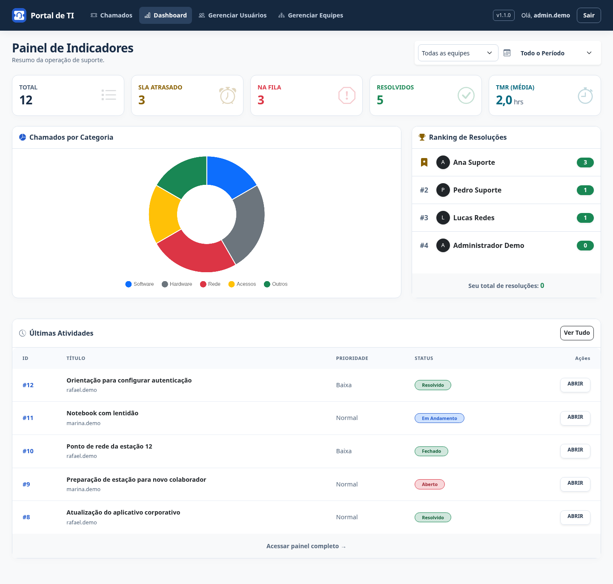
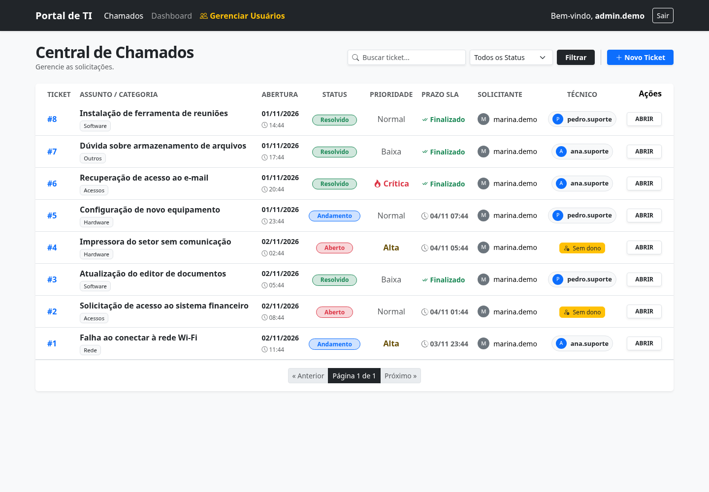
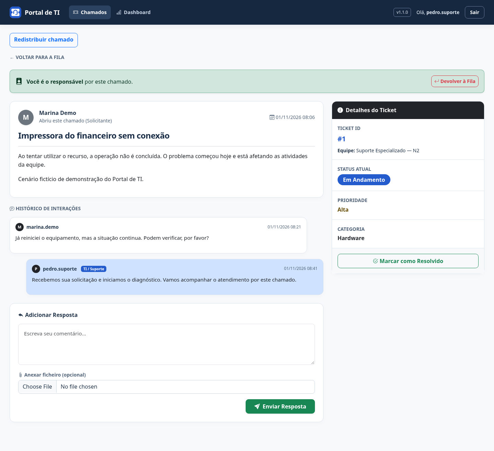
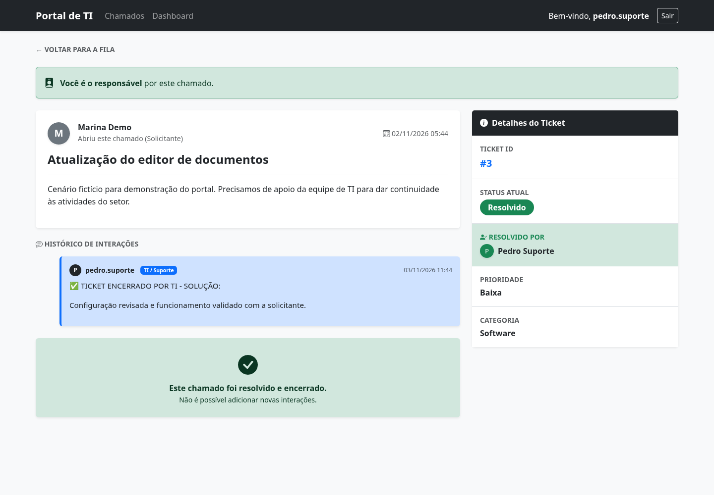
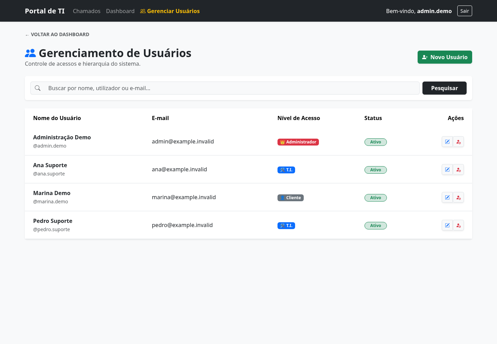
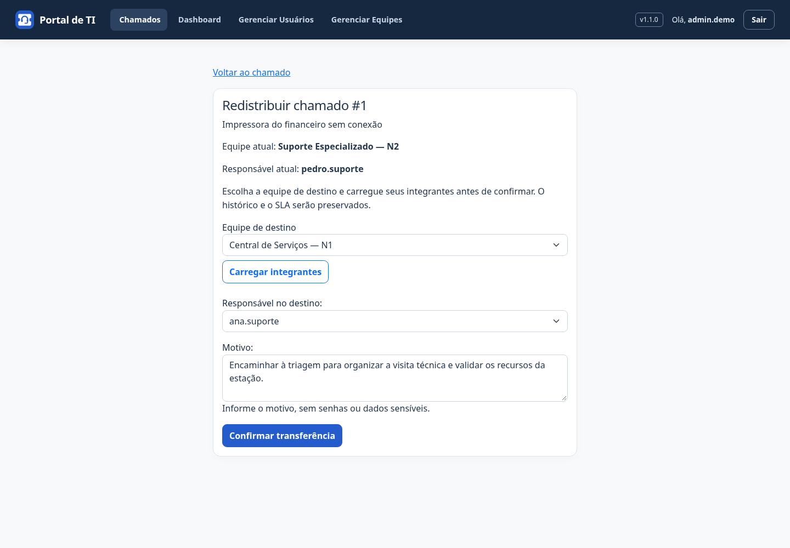
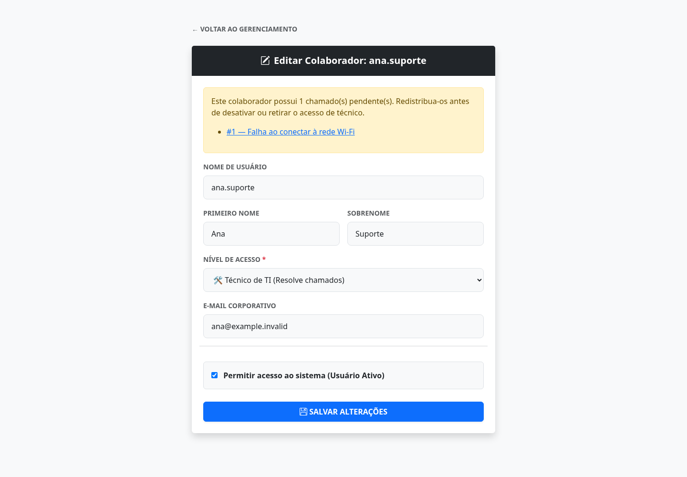
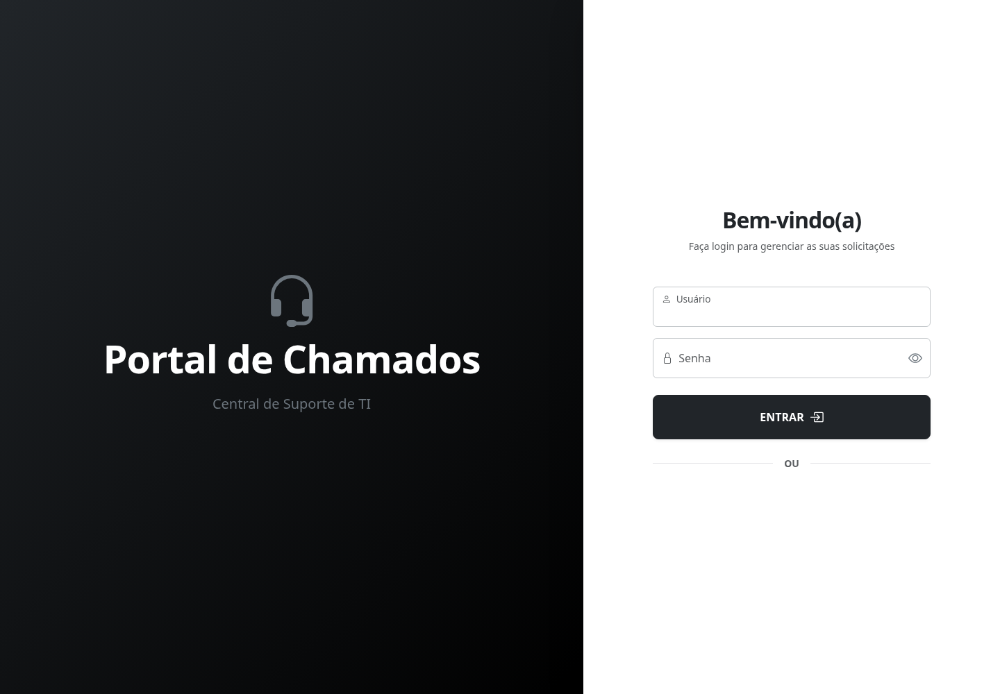

# 🎧 Portal de Chamados - Suporte de TI


Aplicação de Helpdesk e Gestão de Chamados desenvolvida em **Python e Django**, com fila de atendimento, acompanhamento de SLA, indicadores, controle de acesso e trilha de auditoria.

As capturas abaixo mostram a interface da versão atual com **dados fictícios de demonstração**. As imagens ficam versionadas em [`docs/imagens`](docs/imagens), sem depender de anexos externos do GitHub.

---

## ✨ Principais Funcionalidades

### 📊 Dashboard e Métricas (Para a Equipe de TI)


* **Tempo Médio de Resolução (TMR):** Cálculo automático da média de horas levadas para fechar tickets.
* **Controle de SLA Inteligente:** Prazos (SLA) calculados dinamicamente com base na prioridade do chamado (Crítica, Alta, Normal, Baixa), **pulando finais de semana automaticamente**.
* **Gráficos:** Distribuição por categoria e cumprimento de SLA com Chart.js, atualizados ao carregar o painel.
* **Ranking de Produtividade:** Gamificação amigável mostrando a quantidade de tickets resolvidos por cada membro da equipe.

### 🎫 Gestão de Tickets


* **Fila de Chamados:** Listagem responsiva com filtros combinados (Busca por texto + Status + Categoria).
* **Última Interação:** Data e tempo desde a última mensagem/solução, com ordenação por interações recentes ou por chamados ativos sem interação há mais tempo. Essa ordenação mede inatividade da conversa; não identifica quem deve responder.
* **Responsável pelo Atendimento:** Apenas o técnico responsável responde como equipe e encerra o chamado; o solicitante também pode comentar enquanto ele estiver ativo.
* **Histórico Interativo:** Timeline de comentários estilo "chat" entre o usuário e o técnico, com suporte a anexo de prints/arquivos.
* **Encerramento Documentado:** Obrigatoriedade de informar a solução do problema ao fechar um ticket, gerando base de conhecimento.

### 💬 Interação e Resolução de Chamados


* **Histórico Interativo:** Timeline de comentários estilo "chat" entre o usuário solicitante e o técnico responsável.
* **Status e Responsável:** Identificação com cores do estado do chamado e do técnico atribuído.
* **Encerramento Documentado:** Obrigatoriedade de informar a solução do problema ao fechar um ticket. Uma vez resolvido, o chamado é bloqueado para novas interações, garantindo a integridade da base de conhecimento (auditoria).



### 👥 Gerenciamento de Usuários (Admin)


* **Controle de Acessos:** `Cliente` abre e acompanha seus chamados; `Técnico de TI` atende a fila e consulta os indicadores; `Administrador` também gerencia usuários e redistribui chamados.
* **Busca Inteligente:** Barra de pesquisa com filtros avançados para encontrar rapidamente colaboradores por nome, e-mail ou username.
* **Ativação e Bloqueio:** Alterações protegidas por POST e CSRF. Desativar ou retirar o papel de técnico exige redistribuir seus chamados pendentes.
* **Contas Administradas:** Cadastro por administrador, com validação de senha e preservação de pelo menos um administrador ativo.

### 🔄 Redistribuição de Chamados



* **Transferência Administrativa:** Administradores escolhem um técnico ativo e informam o motivo da transferência.
* **Auditoria:** Registro do autor, data, motivo e responsáveis anterior e novo, sem alterar o histórico dos chamados concluídos.
* **Recuperação de Pendências:** Chamados de técnicos inativos podem ser redistribuídos pelo portal.



### 🔒 Autenticação e Segurança


* **Login Local:** Funciona sem configurar Google. Portal e Django Admin compartilham limites de tentativas por conta/IP e por IP.
* **Google SSO:** Integração opcional via Allauth, sujeita à configuração OAuth. Cadastro público está fechado; contas locais não são vinculadas automaticamente ao Google apenas por compartilharem e-mail.
* **Proteção de Rotas:** Bloqueio de acesso não autorizado a páginas administrativas e restrição de visualização de tickets.
* **MFA:** Ainda não implementado; requisitos de adoção e recuperação de acesso estão em [operação](docs/operacao.md).

---

## 🛠️ Tecnologias Utilizadas

* **Back-end:** Python, Django
* **Front-end:** HTML5, CSS3, Bootstrap 5, Ícones do Bootstrap
* **Visualização de Dados:** Chart.js
* **Banco de Dados:** SQLite; uso com maior concorrência exige validação e avaliação de outro banco.
* **Autenticação:** Django Allauth (Google OAuth2)

---

## 🚀 Como rodar o projeto localmente

Siga o passo a passo abaixo para clonar e rodar a aplicação na sua máquina:

Use Python 3.12 (registrado em `.python-version`). As dependências de execução
estão fixadas com hashes em `requirements.txt`; `requirements.in` declara as diretas.

```bash
git clone https://github.com/sonmook/portal-chamados.git
cd portal-chamados
python3 -m venv .venv
.venv/bin/python -m pip install --require-hashes -r requirements.txt
.venv/bin/python manage.py migrate
.venv/bin/python manage.py createsuperuser
.venv/bin/python manage.py runserver
```

No Windows, use `py -3.12 -m venv .venv` e substitua `.venv/bin/python` por
`.\.venv\Scripts\python.exe` nos comandos.
O login local funciona sem Google; configurar OAuth é necessário apenas para login social.
A chave de desenvolvimento é gerada em `.django-secret-key`, ignorada pelo Git;
não a copie para produção. Uma chave local diferente invalida sessões antigas.

Para validar: `python manage.py test`, `python manage.py check --fail-level WARNING`
e `python manage.py makemigrations --check --dry-run`, usando o Python da venv.
Consulte [produção e CI](docs/operacao.md) e [auditoria de dependências](docs/dependencias.md).

## Controles de acesso e anexos

Novas contas são cadastradas por administradores em `/novo-usuario/` ou no Django Admin.
O cadastro público via senha e via Google está fechado. Contas sociais já vinculadas
continuam usando o login existente; cadastrar uma conta local não a vincula automaticamente
à conta Google. A vinculação deve seguir um fluxo autenticado e verificado; não habilite
cadastro público para contornar essa etapa.

Anexos novos aceitam PNG, JPEG e PDF de até 10 MB. Extensão e assinatura básica são
verificadas nas três entradas (abertura, comentário e resolução), inclusive nos formulários
do admin por validação de modelo. Isso não constitui análise antivírus nem decodificação
completa do conteúdo. Os arquivos são entregues como download binário, sem cache compartilhado.
Solicitantes acessam anexos de seus chamados; equipe técnica acessa os chamados da fila.

**Implantação:** mantenha `MEDIA_ROOT` privado. Não configure alias público de `/media/`,
bucket público ou servidor estático apontando para uploads. Os downloads passam pelas rotas
`/chamado/<id>/anexo/` e `/chamado/<id>/comentario/<id>/anexo/` com autorização.
Arquivos antigos permanecem no armazenamento e também passam por essas rotas; não são
revalidados ou removidos automaticamente. Links antigos de `/media/` deixam de funcionar.
Configure no proxy um limite de corpo compatível com 10 MB por arquivo mais o formulário,
e políticas de armazenamento/antivírus conforme a implantação.

Após atualizar, execute `python manage.py migrate` (migração 0009 de validadores) e
`python manage.py test helpdesk`. Ativar/bloquear usuários agora exige POST com CSRF;
integrações que faziam GET nessa rota devem ser atualizadas.


## Login e administração

Execute `python manage.py migrate` após atualizar para aplicar a migração 0012.
Ela preenche a última interação usando a data mais recente registrada entre
abertura, comentários e encerramento, sem alterar mensagens ou criar eventos de
auditoria retroativos. Em novos chamados sem mensagens, a fila usa a abertura.
Comentários e a solução atualizam essa data; alterações administrativas de status,
prioridade ou responsável não representam novas interações. `data_atualizacao`
mantém seu significado anterior, separado da atividade da conversa.

### Equipes — preparação da v1.1.0

Administradores encontram **Gerenciar Equipes** no menu superior. A área permite
criar equipes, editar responsabilidades, selecionar integrantes e coordenadores,
ativar e desativar cadastros. Um técnico pode integrar várias equipes; coordenadores
devem ser integrantes, e as contas selecionadas precisam ter acesso de técnico ativo.
As seis equipes iniciais são Central de Serviços — N1, Suporte Especializado — N2,
Infraestrutura e Redes, Sistemas e Aplicações, Identidades e Acessos e Segurança da Informação.

Execute `python manage.py migrate` para criar o cadastro inicial. Desativar uma
equipe preserva os vínculos. Remoções de integrantes e alterações de coordenadores
ficam registradas na auditoria, com os IDs antes/depois e o administrador responsável.
O Django Admin oferece consulta desses cadastros; a edição é realizada pelo portal.

Esta é a primeira etapa: chamados ainda não são vinculados a equipes, não existe
contagem de pendências por equipe e a coordenação ainda não concede novas permissões.
Filas por equipe, transferência entre equipes e proteção de chamados/anexos serão
implementadas na próxima entrega, antes de publicar a versão v1.1.0.

### Contas e atendimento

Administradores podem usar **Redistribuir chamado** nos detalhes de um chamado
ativo para escolher outro técnico ativo e informar um motivo (até 500 caracteres).
A transferência registra ator, data, responsável anterior/novo e motivo na auditoria;
não informe senhas ou dados sensíveis nesse campo. O novo técnico assume as ações
de atendimento; o solicitante mantém seu acesso. Chamados concluídos não são transferidos.

Antes de desativar ou retirar o acesso de técnico de uma conta, redistribua seus
chamados pendentes. A tela de edição do colaborador mostra links para as pendências
(até 20 por vez). A proteção vale no portal e no formulário do Django Admin;
o responsável do chamado é somente leitura no admin para manter as transferências
nesse fluxo auditado. SQL/ORM direto continua sob responsabilidade do operador.
Uma transferência também pode recuperar chamados já presos a técnicos inativos.

Execute a migração 0010 antes de usar o login local. O limite de `/contas/login/` e `/admin/login/`
conta todos os POSTs que passam pelo CSRF (incluindo os bem-sucedidos): 10 por
conta/IP e 50 por IP em janelas fixas de 15 minutos. Contadores ficam no banco,
com chaves hash, e registros expirados são limpos nas próximas tentativas.
Um bloqueio retorna 429 com Retry-After; a virada de janela permite novas tentativas.
Nomes de conta são normalizados para contagem; o login mantém o comportamento Django.
Não se confia em X-Forwarded-For. Atrás de proxy, configure REMOTE_ADDR no servidor
com uma origem confiável; caso contrário todos os clientes podem compartilhar o limite.
Portal e Django Admin compartilham os contadores; alternar entre essas telas não
renova a cota. O formulário administrativo mantém as restrições de conta ativa e
is_staff. GETs e POSTs rejeitados pelo CSRF não consomem tentativas.
Esse limite não cobre o fluxo OAuth/Allauth e não implementa MFA.
O servidor deve complementar a proteção contra tráfego abusivo e ataques distribuídos.

Edição de contas preserva pelo menos um administrador ativo com acesso ao admin
(is_active/is_staff/is_superuser). No Django Admin é necessário rebaixar um
administrador antes de excluí-lo. Operações SQL/ORM diretas continuam sendo de
responsabilidade do operador. Alterações pelas telas usam transações e bloqueios
de administradores; SQLite não oferece bloqueio de linha e pode rejeitar escritas
concorrentes. Testes de concorrência na infraestrutura de produção ainda são necessários.


## Preservação de histórico e auditoria

A migração 0011 protege usuários referenciados como solicitantes, técnicos,
responsáveis pelo encerramento, autores de comentários ou atores da auditoria.
Excluir essas contas retorna proteção de relacionamento; prefira desativá-las.
Nenhum dado histórico é removido ou anonimizado automaticamente. A política de
retenção e eventual anonimização deve ser definida antes de executar processos
específicos para esse fim, considerando a preservação dos vínculos.

O Django Admin não permite excluir chamados ou comentários, alterar chamados
Resolvidos/Fechados nem editar comentários. Status e encerramento são controlados
pelo fluxo de atendimento, não pelos campos do admin. Comentários novos são
adicionados pelo portal. Chamados com comentários também têm exclusão protegida
no relacionamento do modelo.

Superusuários podem consultar os registros de auditoria no Django Admin, sem
botões de criação, edição ou exclusão. Cada evento inclui data, ator, origem
(portal/admin/sistema), objeto e alterações. Status, IDs de responsáveis, papéis,
ativação e datas têm valores antes/depois. Nomes, e-mail, senha, descrição,
comentários e caminhos de anexos são registrados apenas como campo alterado;
nem senhas nem hashes são armazenados nessa trilha. Mudanças de grupos e
permissões diretas dos usuários registram os IDs envolvidos.

A coleta começa após a migração, sem reconstruir eventos anteriores. Alterações
fora de requisições identificadas pelo middleware ficam com ator vazio e origem
sistema. Isso não constitui log imutável contra administradores do banco:
SQL direto, QuerySet.update/bulk_create e mudanças externas não passam pelos
signals. A atribuição condicional de chamados tem registro explícito na view.
As rotas de alteração do portal e o admin usam transações para preservar a
consistência do registro e da alteração. Integrações futuras devem também usar
transações e registrar atualizações em lote explicitamente. Operações de terminal
fora de transação não oferecem a mesma atomicidade.

Backups abrangem banco, uploads privados e trilha de auditoria juntos. O fluxo
automatizado de homologação valida restauração isolada e completude dos anexos
referenciados no banco. Concorrência real em produção e retenção em armazenamento
externo protegido contra adulteração continuam dependentes da implantação.


## Homologação

A preparação Docker/HTTPS, envio SMTP e procedimentos de backup/restauração estão em
[docs/homologacao.md](docs/homologacao.md). Publicação exige servidor, domínio e acesso
ao provedor; o teste local automatizado não significa que uma URL pública foi criada.
