# Nexaltri — Gestão de chamados e atendimento de TI


**Versão do código: 1.17.1** · [Notas da versão](docs/releases/v1.17.1.md) · [Identidade visual](docs/identidade-visual.md) · [Evolução visual](docs/evolucao-visual.md) · [Releases oficiais](https://github.com/sonmook/portal-chamados/releases) · [Publicação de versões](docs/versionamento.md)


Aplicação de Helpdesk e Gestão de Chamados desenvolvida em **Python e Django**, com fila de atendimento, acompanhamento de SLA, indicadores, controle de acesso e trilha de auditoria.

As capturas das telas do portal mostram a **Nexaltri v1.15.0**; a prévia do relatório Excel pertence à **v1.17.0**. Todas usam **dados fictícios de demonstração**. As imagens ficam em [`docs/imagens/v1.15.0`](docs/imagens/v1.15.0) e [`docs/imagens/v1.17.0`](docs/imagens/v1.17.0). A [galeria de evolução visual](docs/evolucao-visual.md) preserva as versões anteriores.

---

## Atualizações do projeto

### v1.17.1 — Correção de compatibilidade do relatório com o Excel

Corrige a configuração de impressão duplicada nas abas do arquivo `.xlsx`, que podia provocar o aviso **“Encontramos um problema em um conteúdo”** no Microsoft Excel. As margens do modelo são atualizadas sem criar um segundo elemento; dados, filtros, marca, gráficos e tabelas permanecem com os mesmos critérios.

A validação passa a conferir a estrutura de impressão de cada aba e a usar o **Open XML SDK da Microsoft** na CI para verificar o modelo e um relatório gerado em banco temporário, incluindo um controle que precisa rejeitar a duplicação anterior. Abertura no LibreOffice ou leitura de ZIP/XML, isoladamente, não comprovam compatibilidade com o Excel.

**Como aplicar:** atualize o projeto, valide, reinicie e **exporte o arquivo novamente**. O código novo não altera arquivos já baixados. Sem migração ou nova dependência da aplicação. [Notas da v1.17.1](docs/releases/v1.17.1.md) · [Validação do formato](docs/relatorio-excel.md#validação-do-formato).

### v1.17.0 — Relatório Excel com identidade Nexaltri

Em **Administração → Indicadores**, aplique equipe e período e clique em **Exportar Excel formatado**. O arquivo `.xlsx` reúne o relatório completo, com marca Nexaltri, azul-marinho e turquesa, indicadores em destaque e gráficos editáveis.

- **Resumo:** nove indicadores, gráficos de SLA e categorias, período, equipe, data de geração e critérios de contagem.
- **Desempenho:** tabelas de equipes, analistas e top 20 solicitantes, com cabeçalhos formatados e filtros.
- **Resoluções:** todos os ciclos dos filtros aplicados, com datas e números próprios do Excel, duração em horas, cabeçalho fixado e destaque de SLA.
- **Mesmas regras da tela:** preservação do histórico de reabertura e transferência, distinção entre resultados no período e fila atual, ausência de SLA identificada como sem dados e download exclusivo de administradores ativos.
- **CSV preservado:** continua disponível para os dados dos ciclos. O Excel é a opção para apresentação visual.

**Validação local:** 565 testes aprovados, abas renderizadas e arquivo aberto no LibreOffice Calc, com conferência de indicadores, gráficos e datas nativas. Sem nova migração ou dependência de execução. [Uso, conteúdo e validação](docs/relatorio-excel.md) · [Notas da v1.17.0](docs/releases/v1.17.0.md).

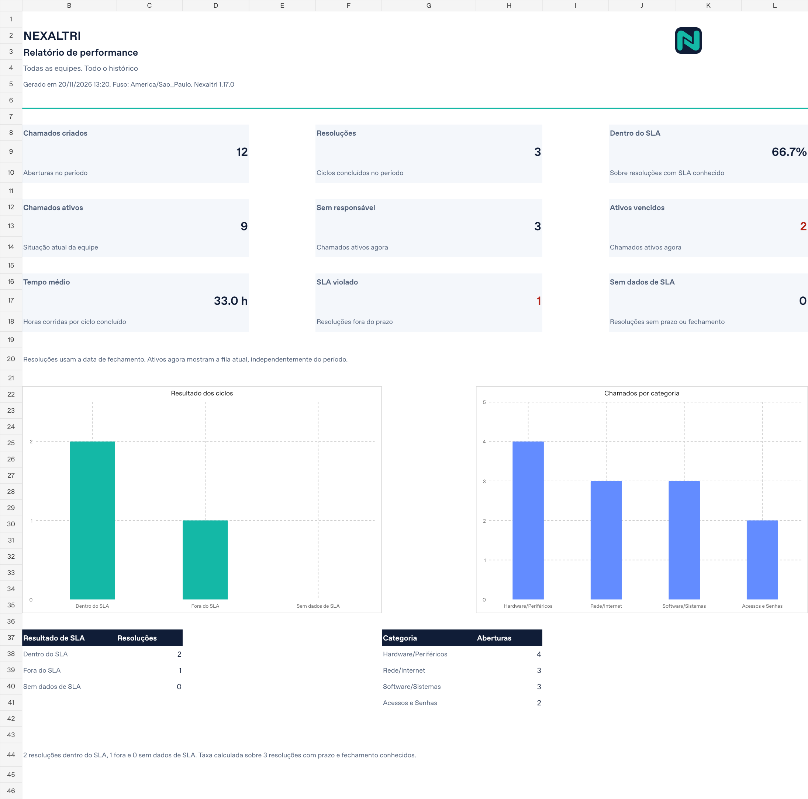

### v1.16.0 — Exportação dos indicadores para CSV

Agora o administrador pode baixar as resoluções do relatório para analisar no Excel ou apresentar os resultados do atendimento.

- **Onde usar:** Administração → Indicadores → aplique equipe e período → Ciclos concluídos → **Exportar CSV**.
- **Todos os resultados:** o arquivo inclui todas as páginas dos filtros aplicados, com uma linha por ciclo concluído.
- **Histórico preservado:** número do chamado e do ciclo, título, equipe e autor registrados na resolução, status do ciclo, início, vencimento, fechamento e resultado de SLA. Reabrir ou transferir o chamado mantém os resultados anteriores.
- **Leitura no Excel:** UTF-8 com acentos, separador ponto e vírgula, datas no fuso do portal e proteção de textos que poderiam ser interpretados como fórmulas.
- **Controle de acesso:** download exclusivo de administradores ativos. Filtros inválidos exibem os erros no formulário.

**Validação da entrega:** 553 testes, 42 verificações visuais e os cinco jobs da CI aprovados, incluindo o download em desktop, tablet e celular. [Execução validada](https://github.com/sonmook/portal-chamados/actions/runs/44757295256).

**Atualização da instalação:** sem nova migração ou dependência de execução. As [notas da v1.16.0](docs/releases/v1.16.0.md) descrevem a atualização; o [guia de exportação](docs/indicadores-administracao.md#exportar-resoluções-para-csv-v1160) detalha colunas, filtros e formato.

### Histórico das versões

| Versão | Principais atualizações |
| --- | --- |
| [v1.17.1](docs/releases/v1.17.1.md) | Corrige margens duplicadas no Excel e adiciona validação do formato com Open XML SDK. |
| [v1.17.0](docs/releases/v1.17.0.md) | Relatório Excel com identidade Nexaltri, resumo visual, gráficos, desempenho e ciclos detalhados. |
| [v1.16.0](docs/releases/v1.16.0.md) | Exportação CSV dos indicadores, com filtros, todos os ciclos concluídos e acesso administrativo. |
| [v1.15.0](docs/releases/v1.15.0.md) | Identidade Nexaltri, fontes locais, login e navegação renovados, validação visual e galeria histórica. |
| [v1.14.0](docs/releases/v1.14.0.md) | Notas e anexos internos da TI, com permissões, notificações e histórico técnico. |
| [v1.13.0](docs/releases/v1.13.0.md) | Reabertura com justificativa, ciclos de atendimento e preservação dos resultados anteriores. |
| [v1.12.0](docs/releases/v1.12.0.md) | Aguardando solicitante e Aguardando fornecedor, com motivo e histórico das transições. |
| [v1.11.0](docs/releases/v1.11.0.md) | Calendário de SLA com fuso, expediente e feriados; cobertura administrativa da triagem. |
| [v1.10.1](docs/releases/v1.10.1.md) | Busca por número, categoria visível, períodos consistentes e validação das atualizações em um comando. |
| [v1.10.0](docs/releases/v1.10.0.md) | Respostas prontas e relatório de performance administrativo. |
| [v1.9.0](docs/releases/v1.9.0.md) | Ordem pessoal das colunas, persistida na conta e ajustável por arraste ou teclado. |
| [v1.8.0](docs/releases/v1.8.0.md) | Resumo operacional clicável da fila e inicialização conjunta do portal e alertas no Windows. |
| [v1.7.0](docs/releases/v1.7.0.md) | Central de Administração e consulta de auditoria no portal. |
| [v1.6.0](docs/releases/v1.6.0.md) | Alertas de SLA próximo ou vencido e filtros por prazo. |
| [v1.5.0](docs/releases/v1.5.0.md) | Sino, contador e central de notificações pessoais. |
| [v1.4.0](docs/releases/v1.4.0.md) | Catálogo de conquistas, perfis completos e melhorias na apresentação das medalhas. |
| [v1.3.0](docs/releases/v1.3.0.md) | Conquistas individuais e por equipe, com progresso e regras de concessão. |
| [v1.2.0](docs/releases/v1.2.0.md) | Meu Perfil, edição de dados profissionais e enquadramento da foto. |
| [v1.1.0](docs/releases/v1.1.0.md) | Atendimento por equipes, encaminhamento por categoria e primeira identidade visual do Portal de TI. |

O [CHANGELOG completo](CHANGELOG.md) registra os detalhes, os ajustes pontuais e as atualizações anteriores ao versionamento. As [notas por versão](docs/releases) explicam funcionamento e atualização; a [evolução visual](docs/evolucao-visual.md) preserva as capturas anteriores. O [guia de versionamento](docs/versionamento.md#registro-das-atualizações-no-readme) define como manter esse histórico em cada entrega.

## Identidade Nexaltri

A **v1.15.0** aplica a identidade Nexaltri ao portal: monograma N em SVG, assinaturas clara/escura, navegação clara, turquesa e azul-marinho, fontes Manrope/Inter locais, login e ícones próprios. Cores semânticas de SLA e status permanecem identificadas por texto. CSS e ícones usam a versão na URL para atualizar o cache do navegador. A CI inclui Chromium em desktop, tablet e celular, com capturas e dados fictícios em banco temporário. [Identidade e critérios visuais](docs/identidade-visual.md).

## Notas internas da TI

A **v1.14.0** adiciona notas e anexos internos para colaboração dos técnicos da equipe atual e administradores. O formulário é separado da resposta pública; solicitantes sem acesso técnico não recebem texto, anexo ou aviso. A nota não altera espera, prazo ou última interação pública. [Permissões, uso e atualização](docs/notas-internas.md).

## Reabertura e ciclos de atendimento

A **v1.13.0** permite ao solicitante ou técnico responsável reabrir um chamado com motivo obrigatório. Mantém o número, a conversa e as soluções anteriores, e inicia um novo prazo conforme prioridade e calendário atuais. Cada ciclo concluído guarda início, prazo, fechamento, equipe e autor; os indicadores identificam os ciclos e as conquistas continuam contando uma única resolução por chamado. [Regras e atualização](docs/reabertura-chamados.md).

## Estados de espera do atendimento

A **v1.12.0** adiciona **Aguardando solicitante** e **Aguardando fornecedor**. O técnico responsável informa um motivo e o portal registra autor, data e histórico da alteração. A resposta do solicitante retoma automaticamente o atendimento quando a espera era por ele. Os chamados continuam ativos na fila, nos indicadores e nos alertas: **o SLA continua contando durante a espera**. [Funcionamento e atualização](docs/estados-espera.md).

## Calendário de SLA e cobertura da triagem

A **v1.11.0** calcula novos vencimentos no fuso da instalação, com dias, expediente e feriados configuráveis. O padrão é **24 horas de segunda a sexta, em America/Sao_Paulo**, mantendo os prazos por prioridade. Vencimentos existentes são preservados. A Administração mostra o calendário vigente e equipes sem coordenador ativo. Nessa situação, os avisos de chamados sem responsável chegam aos administradores ativos. [Configuração e critérios](docs/calendario-sla.md).

## Correções da fila e validação das atualizações

A **v1.10.1** permite buscar por número (`123` ou `#123`), selecionar categoria diretamente na fila e corrigir erros de resolução sem perder o texto da solução. Dashboard e indicadores usam os mesmos limites de datas: **Últimos 7 dias** inclui hoje e os seis dias anteriores, no fuso ativo do portal.

Execute `python scripts/validar_atualizacao.py` com o Python da venv para validar versão, dependências, configuração, migrações e testes em um comando. A CI executa a mesma validação em cada PR e publica um resumo por etapa; os jobs de dependências, homologação e Windows continuam separados. [Funcionamento e limites](docs/validacao-atualizacoes.md).

## Indicadores administrativos — relatório de performance

Na **v1.16.0**, use **Exportar CSV** na seção **Ciclos concluídos** para baixar todas as resoluções dos filtros aplicados, incluindo as outras páginas. O arquivo abre no Excel com acentos, uma linha por ciclo, equipe e autor históricos, datas no fuso do portal e resultado de SLA. O acesso continua exclusivo de administradores ativos. [Formato, filtros e cuidados com os dados](docs/indicadores-administracao.md#exportar-resoluções-para-csv-v1160).

Acesse **Administração → Indicadores** com uma conta de administrador ativo para consultar o relatório de performance. O visual acompanha a identidade Nexaltri, com cabeçalho claro, destaque turquesa, cards compactos e layout responsivo.

- Resumo de chamados criados, resoluções com SLA violado, percentual dentro do SLA e chamados ativos sem responsável.
- Panorama de SLA, distribuição pelas categorias atuais, desempenho por equipe, ranking de resoluções por analista e top 20 solicitantes por volume de chamados.
- Lista clicável de resoluções fora do prazo e detalhamento paginado dos resolvidos.
- Filtros por equipe, incluindo inativas, e por período: hoje, últimos 7 dias, mês, histórico completo ou intervalo personalizado.

Cada ciclo concluído conta uma resolução; reaberturas preservam os resultados anteriores. Criações são filtradas pela data de abertura; resoluções, pela data de fechamento. Os percentuais de SLA consideram apenas resoluções com fechamento e vencimento conhecidos. Ativos vencidos e chamados sem responsável mostram a situação atual, independentemente do período, e aparecem separados das resoluções fora do prazo. O dashboard mantém as contagens de chamados por situação atual; SLA, TMR e produtividade usam ciclos concluídos no recorte de chamados criados no período. [Critérios e funcionamento](docs/indicadores-administracao.md).

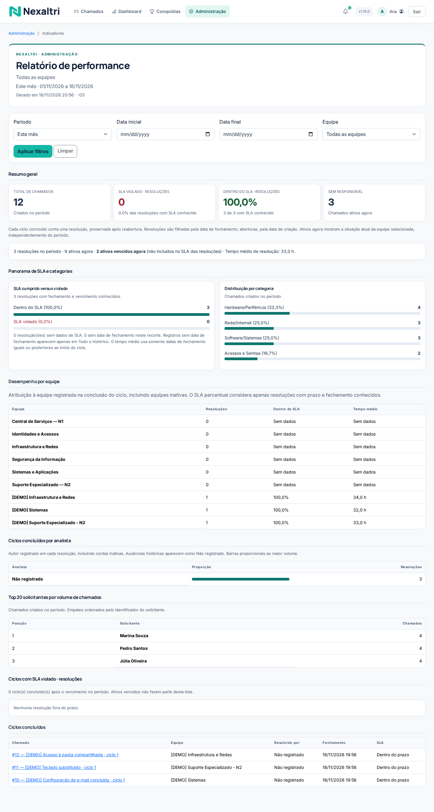

## Respostas prontas

A **v1.10.0** adiciona modelos de texto para o técnico responsável por um chamado ativo. Escolha um modelo para acrescentá-lo ao rascunho, adapte o texto e clique em Enviar resposta. Administradores criam, editam e desativam os modelos em **Administração → Respostas prontas**. Três exemplos iniciais ajudam a começar; selecionar um modelo não envia mensagens nem altera o status do chamado. [Funcionamento](docs/respostas-prontas.md).

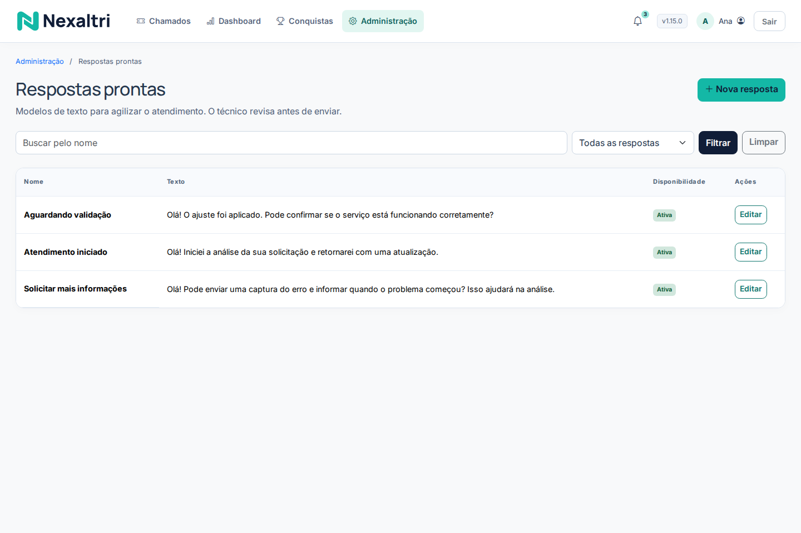

## Colunas na sua ordem

A **v1.9.0** permite arrastar os títulos da tabela de chamados para mudar a sequência das colunas. A ordem é salva automaticamente na conta e mantida ao filtrar, paginar ou voltar ao portal. No celular, mantenha o dedo no título e arraste para os lados. Também há movimento por teclado e um comando discreto para restaurar a ordem padrão. [Funcionamento](docs/ordem-colunas.md).

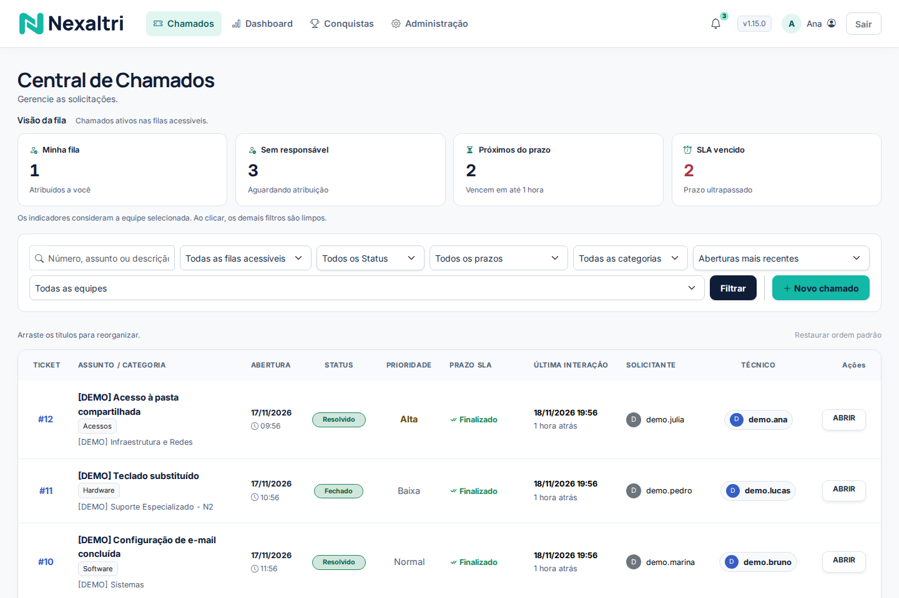

## Iniciar no Windows

Com a `.venv` preparada, inicie o portal e os alertas no mesmo terminal:

```powershell
.\iniciar-portal.cmd
```

O inicializador localiza a pasta do projeto, verifica Python/dependências/migrações/porta e inicia os dois serviços. **Ctrl+C** encerra ambos. Não instala pacotes, aplica migrações ou cria usuários automaticamente. `tzdata` já está fixado com hashes para a instalação no Windows. [Preparação e solução de erros](docs/inicializacao-windows.md).

## Resumo operacional da fila

A **v1.8.0** adiciona quatro indicadores clicáveis na Central de Chamados: **Minha fila**, **Sem responsável**, **Próximos do prazo** e **SLA vencido**. As quantidades seguem as permissões e a equipe selecionada. Ao clicar, os outros filtros são limpos e a lista abre no recorte escolhido. Também é possível combinar o novo filtro Sem responsável com prazo, busca e ordenação. Disponível para técnicos e administradores. [Critérios e uso](docs/resumo-operacional.md).


## Administração

A **v1.7.0** reúne a gestão em um único acesso **Administração** no cabeçalho. Administradores encontram Usuários, Equipes, Encaminhamento, Conquistas e Auditoria em uma central discreta, com acesso protegido também pelo servidor. A Auditoria abre no próprio portal, com filtros e detalhes somente para consulta. As telas de gestão mostram o caminho de volta à central. [Funcionamento](docs/administracao.md).

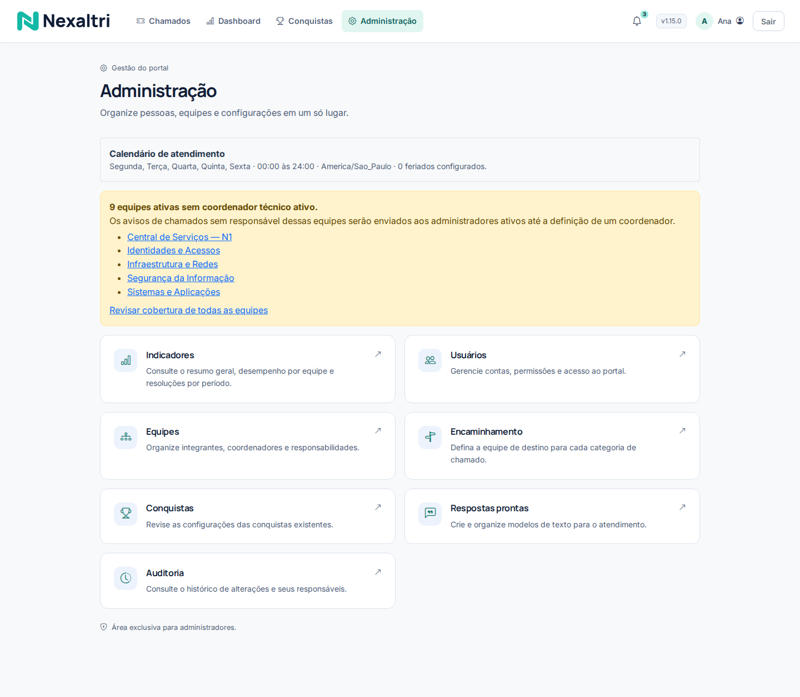

## Alertas de SLA

A **v1.6.0** avisa o responsável quando faltar até **1 hora** para o prazo ou quando o SLA vencer. Chamados sem responsável são sinalizados aos coordenadores da equipe, sem repetir o mesmo aviso. Use **Próximos do prazo (até 1h)** e **SLA vencido** junto de **Minha fila** para priorizar o atendimento. O Docker inicia a verificação automaticamente; no Windows, `iniciar-portal.cmd` inicia o portal e esse processo juntos. [Configuração e critérios](docs/alertas-sla.md).

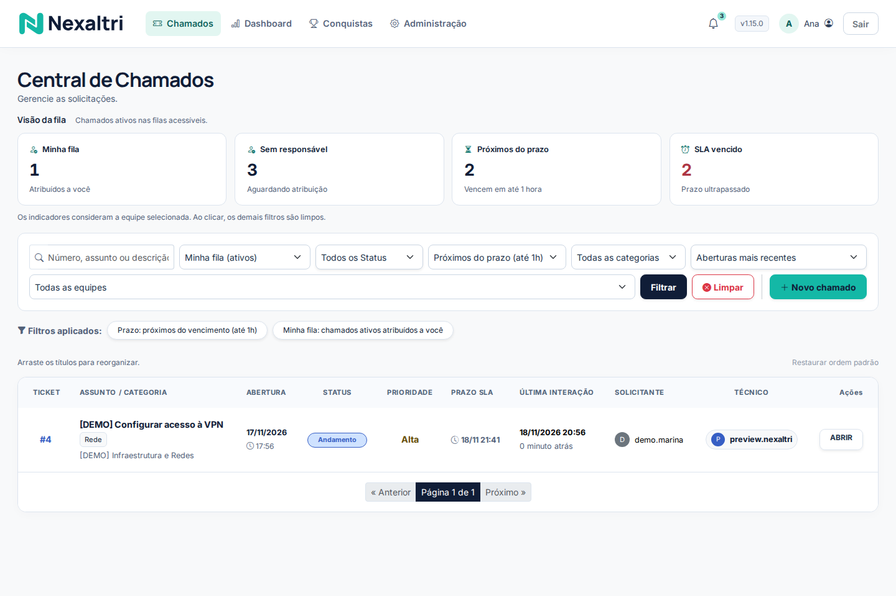

## Notificações

A **v1.5.0** adiciona um sino no cabeçalho, com contador de avisos não lidos, e uma central de notificações pessoais. Receba avisos de atribuição, nova resposta, transferência e resolução; abra o chamado pelo aviso ou marque uma/todas como lidas. Só aparecem notificações de chamados aos quais você ainda tem acesso. O contador é atualizado ao navegar ou recarregar a página. [Funcionamento e destinatários](docs/notificacoes.md).

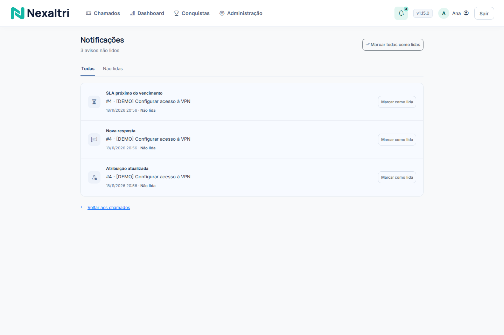

## Conquistas

O portal já vem com **12 conquistas predefinidas**, concedidas automaticamente: marcos individuais de resoluções, atendimento dentro do SLA e resultados coletivos. Entre elas: Missão cumprida, Centurião do suporte, Guardião do SLA e Força-tarefa. Acompanhe o progresso em **Conquistas** e veja suas medalhas em uma vitrine discreta na lateral do perfil. Na coleção, cada conquista mostra apenas ícone e nome. Passe o mouse sobre a conquista para consultar os detalhes flutuantes; no celular, toque. O mesmo comportamento está disponível nas medalhas do perfil. Não há opção de criar novas conquistas. O administrador consulta o catálogo e gerencia as configurações existentes sem apagar medalhas recebidas. [Critérios e operação](docs/conquistas.md).

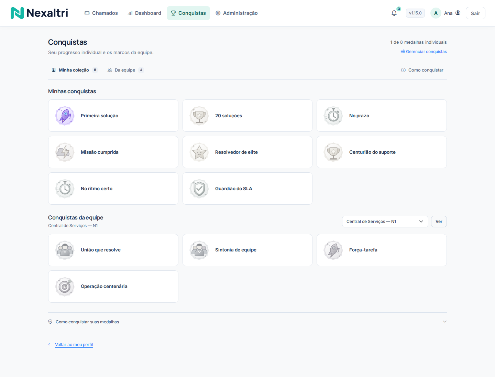

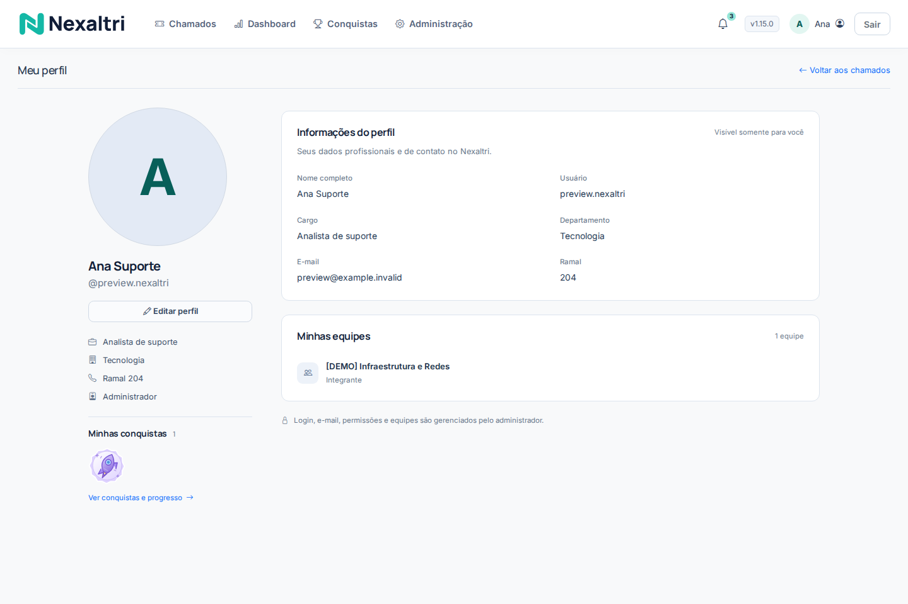

## Meu Perfil

Acesse **Meu Perfil** pelo avatar ou nome no cabeçalho para visualizar foto, dados profissionais, equipes e medalhas discretas. Use **Editar perfil** para alterar nome, sobrenome, cargo, departamento, ramal e foto, com ajuste de posição e zoom, em uma tela separada. Ao salvar, você retorna à visualização. Login, e-mail, permissões e equipes continuam sob administração. As fotos aparecem no cabeçalho e nas conversas e exigem autenticação para acesso. [Detalhes e atualização](docs/perfis.md).

## ✨ Principais Funcionalidades

### 📊 Dashboard e Métricas (Para a Equipe de TI)
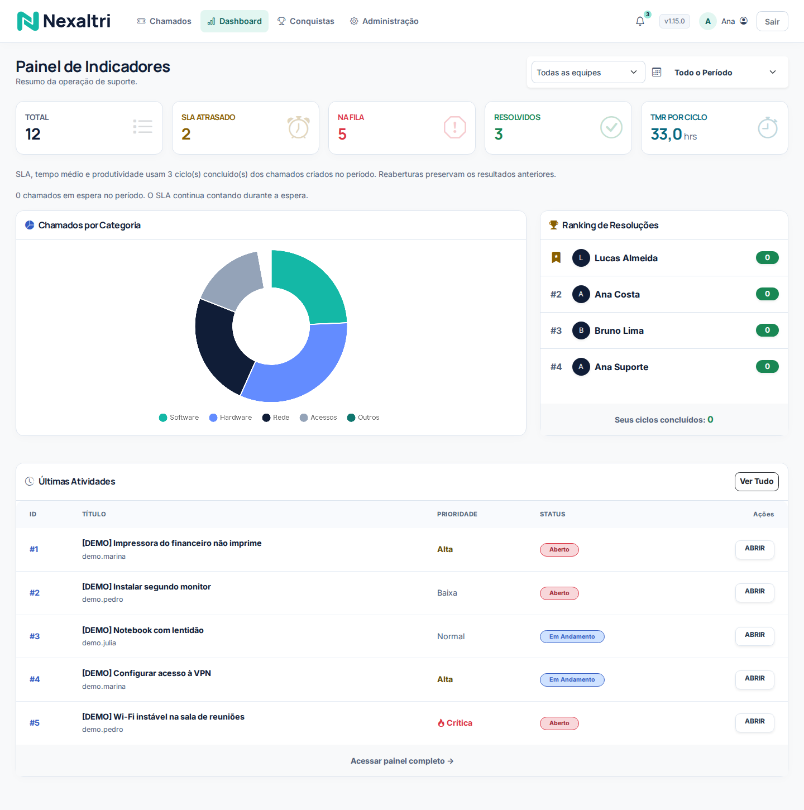

* **Tempo Médio de Resolução (TMR):** Cálculo automático da média de horas levadas para fechar tickets.
* **Controle de SLA Inteligente:** Prazos (SLA) calculados dinamicamente com base na prioridade do chamado (Crítica, Alta, Normal, Baixa), **pulando finais de semana automaticamente**.
* **Gráficos:** Distribuição por categoria e cumprimento de SLA com Chart.js, atualizados ao carregar o painel.
* **Ranking de Produtividade:** Gamificação amigável mostrando a quantidade de tickets resolvidos por cada membro da equipe.

### 🎫 Gestão de Tickets


* **Minha fila:** técnicos e administradores filtram chamados ativos atribuídos à própria conta. O filtro combina com busca, status, equipe e ordenação e permanece na paginação. [Como usar](docs/minha-fila.md).
* **Fila de Chamados:** Listagem responsiva com filtros combinados (Busca por texto + Status + Categoria).
* **Última Interação:** Data e tempo desde a última mensagem/solução, com ordenação por interações recentes ou por chamados ativos sem interação há mais tempo. Essa ordenação mede inatividade da conversa; não identifica quem deve responder.
* **Responsável pelo Atendimento:** Apenas o técnico responsável responde como equipe e encerra o chamado; o solicitante também pode comentar enquanto ele estiver ativo.
* **Histórico Interativo:** Timeline de comentários estilo "chat" entre o usuário e o técnico, com suporte a anexo de prints/arquivos.
* **Encerramento Documentado:** Obrigatoriedade de informar a solução do problema ao fechar um ticket, gerando base de conhecimento.

### 💬 Interação e Resolução de Chamados
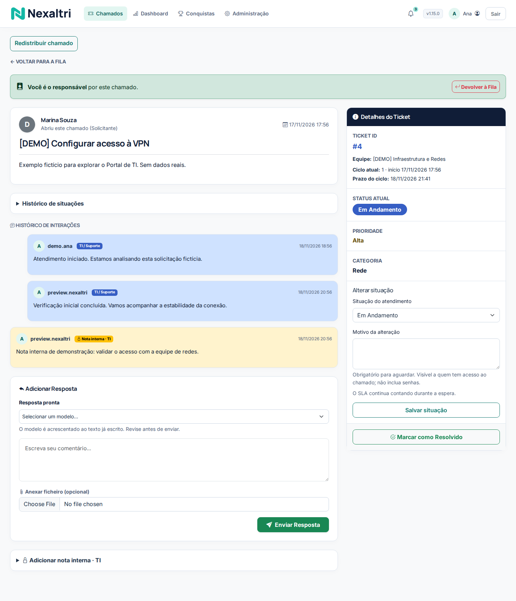

* **Histórico Interativo:** Timeline de comentários estilo "chat" entre o usuário solicitante e o técnico responsável.
* **Status e Responsável:** Identificação com cores do estado do chamado e do técnico atribuído.
* **Encerramento Documentado:** Obrigatoriedade de informar a solução do problema ao fechar um ticket. Uma vez resolvido, o chamado é bloqueado para novas interações, garantindo a integridade da base de conhecimento (auditoria).

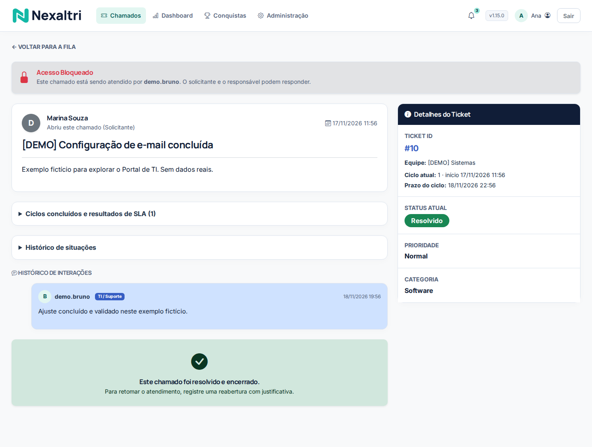

### 👥 Gerenciamento de Usuários (Admin)
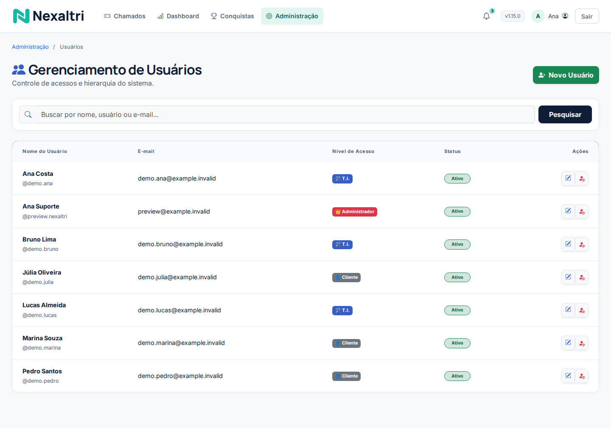

* **Controle de Acessos:** `Cliente` abre e acompanha seus chamados; `Técnico de TI` atende as filas das suas equipes e consulta indicadores dentro do seu acesso; `Administrador` também gerencia usuários e redistribui chamados.
* **Busca Inteligente:** Barra de pesquisa com filtros avançados para encontrar rapidamente colaboradores por nome, e-mail ou username.
* **Ativação e Bloqueio:** Alterações protegidas por POST e CSRF. Desativar ou retirar o papel de técnico exige redistribuir seus chamados pendentes.
* **Contas Administradas:** Cadastro por administrador, com validação de senha e preservação de pelo menos um administrador ativo.

### 🔄 Redistribuição de Chamados

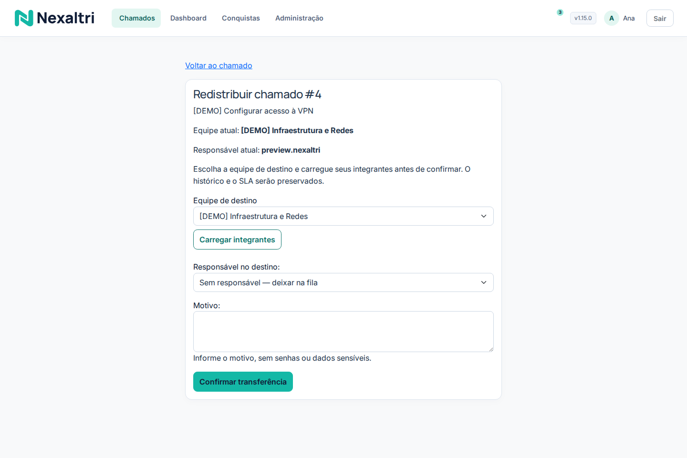

* **Distribuição e Transferência:** Coordenadores distribuem chamados das equipes que coordenam; administradores têm visão geral. O destino pode ser outra equipe ativa, com responsável opcional entre seus integrantes ativos e motivo obrigatório.
* **Auditoria:** Registro do autor, data, motivo e responsáveis anterior e novo, sem alterar o histórico dos chamados concluídos.
* **Recuperação de Pendências:** Chamados de técnicos inativos podem ser redistribuídos pelo portal.

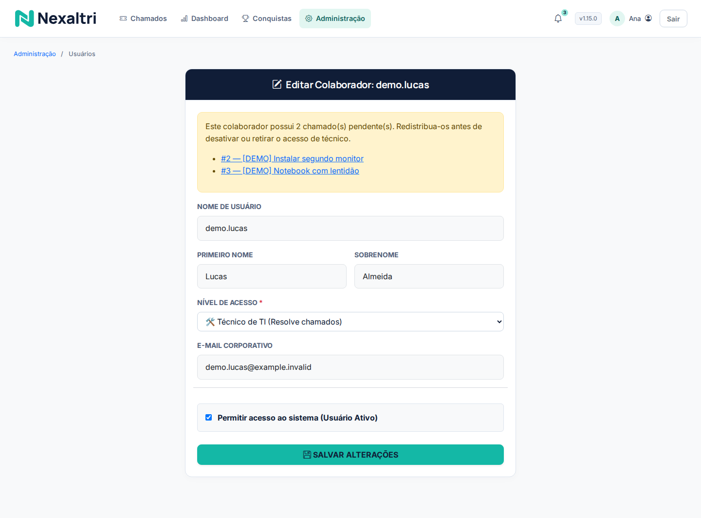

### 👥 Gestão de Equipes

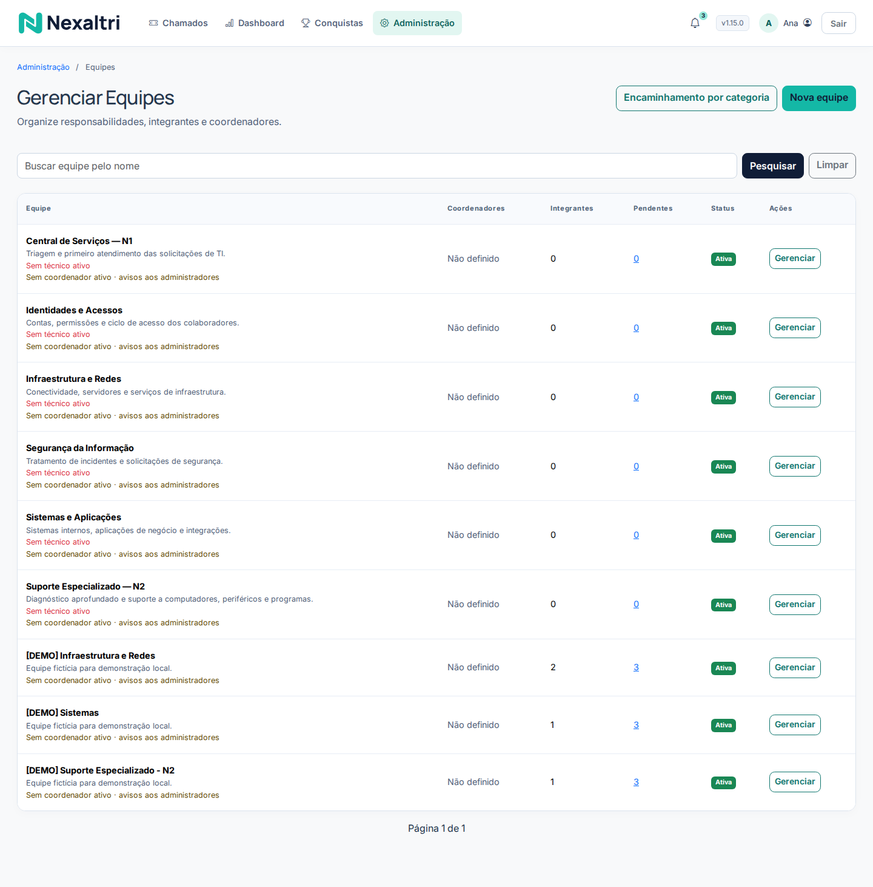

* **Administração no portal:** Cadastro e edição de equipes, integrantes e coordenadores em **Gerenciar Equipes**.
* **Organização do atendimento:** Cada equipe tem sua fila e seus indicadores; um técnico pode participar de mais de uma equipe.

### 🧭 Encaminhamento automático por categoria

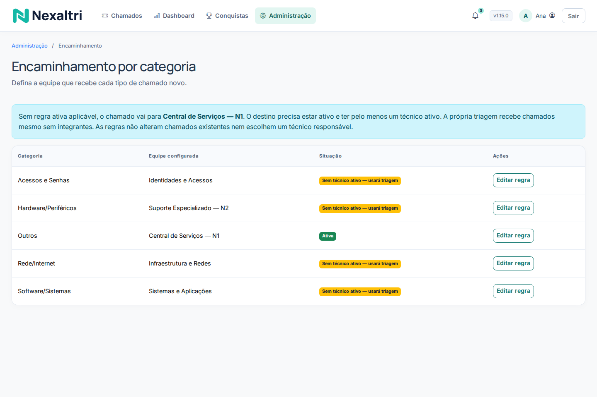

Administradores configuram as regras em **Gerenciar Equipes → Encaminhamento por categoria**.
A configuração inicial é:

| Categoria | Equipe de destino |
| --- | --- |
| Rede | Infraestrutura e Redes |
| Acessos | Identidades e Acessos |
| Hardware | Suporte Especializado — N2 |
| Software | Sistemas e Aplicações |
| Outros | Equipe de triagem, inicialmente Central de Serviços — N1 |

O encaminhamento vale apenas na abertura, pelo portal ou pelo Django Admin, e
não escolhe um técnico: o chamado entra na fila da equipe. Sem regra ativa, com
destino inativo ou sem integrantes com conta ativa e acesso de técnico, segue
para a triagem. A própria triagem recebe chamados mesmo sem integrantes. Essa
verificação considera o cadastro, não a presença online dos técnicos.

A tela mostra quando uma regra usará a triagem. Alterações de regras e decisões
de encaminhamento ficam na auditoria. Chamados já abertos e transferências manuais
mantêm suas equipes. A migração 0016 cria as regras sem reclassificar o histórico;
se uma equipe padrão foi renomeada antes da atualização, a regra correspondente
fica desativada na triagem para revisão, sem recriar equipes.

### 🔒 Autenticação e Segurança
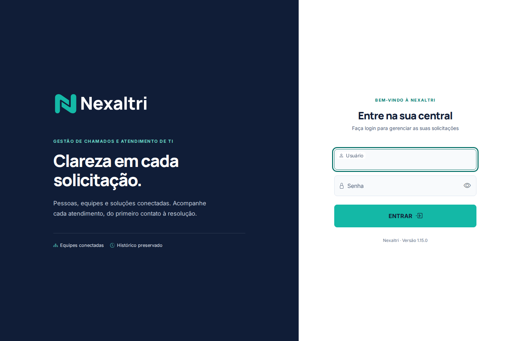

* **Login Local:** Funciona sem configurar Google. Portal e Django Admin compartilham limites de tentativas por conta/IP e por IP.
* **Google SSO:** Integração opcional via Allauth, sujeita à configuração OAuth. Cadastro público está fechado; contas locais não são vinculadas automaticamente ao Google apenas por compartilharem e-mail.
* **Proteção de Rotas:** Bloqueio de acesso não autorizado a páginas administrativas e restrição de visualização de tickets.
* **MFA:** Ainda não implementado; requisitos de adoção e recuperação de acesso estão em [operação](docs/operacao.md).

---

## 🛠️ Tecnologias Utilizadas

* **Back-end:** Python, Django
* **Front-end:** HTML5, CSS3, Bootstrap 5, Ícones do Bootstrap
* **Visualização de Dados:** Chart.js
* **Banco de Dados:** SQLite; uso com maior concorrência exige validação e avaliação de outro banco.
* **Autenticação:** Django Allauth (Google OAuth2)

---

## 🚀 Como rodar o projeto localmente

Siga o passo a passo abaixo para clonar e rodar a aplicação na sua máquina:

Use Python 3.12 (registrado em `.python-version`). As dependências de execução
estão fixadas com hashes em `requirements.txt`; `requirements.in` declara as diretas.

```bash
git clone https://github.com/sonmook/portal-chamados.git
cd portal-chamados
python3 -m venv .venv
.venv/bin/python -m pip install --require-hashes -r requirements.txt
.venv/bin/python manage.py migrate
.venv/bin/python manage.py createsuperuser
.venv/bin/python manage.py runserver
```

No Windows, use `py -3.12 -m venv .venv` e substitua `.venv/bin/python` por
`.\.venv\Scripts\python.exe` nos comandos.
O login local funciona sem Google; configurar OAuth é necessário apenas para login social.
A chave de desenvolvimento é gerada em `.django-secret-key`, ignorada pelo Git;
não a copie para produção. Uma chave local diferente invalida sessões antigas.

Para validar: `python manage.py test`, `python manage.py check --fail-level WARNING`
e `python manage.py makemigrations --check --dry-run`, usando o Python da venv.
Consulte [produção e CI](docs/operacao.md) e [auditoria de dependências](docs/dependencias.md).

## Controles de acesso e anexos

Novas contas são cadastradas por administradores em `/novo-usuario/` ou no Django Admin.
O cadastro público via senha e via Google está fechado. Contas sociais já vinculadas
continuam usando o login existente; cadastrar uma conta local não a vincula automaticamente
à conta Google. A vinculação deve seguir um fluxo autenticado e verificado; não habilite
cadastro público para contornar essa etapa.

Anexos novos aceitam PNG, JPEG e PDF de até 10 MB. Extensão e assinatura básica são
verificadas nas três entradas (abertura, comentário e resolução), inclusive nos formulários
do admin por validação de modelo. Isso não constitui análise antivírus nem decodificação
completa do conteúdo. Os arquivos são entregues como download binário, sem cache compartilhado.
Solicitantes acessam anexos de seus chamados; técnicos acessam anexos das equipes ativas das quais participam. A mesma regra protege fila, detalhes, comentários e indicadores.

**Implantação:** mantenha `MEDIA_ROOT` privado. Não configure alias público de `/media/`,
bucket público ou servidor estático apontando para uploads. Os downloads passam pelas rotas
`/chamado/<id>/anexo/` e `/chamado/<id>/comentario/<id>/anexo/` com autorização.
Arquivos antigos permanecem no armazenamento e também passam por essas rotas; não são
revalidados ou removidos automaticamente. Links antigos de `/media/` deixam de funcionar.
Configure no proxy um limite de corpo compatível com 10 MB por arquivo mais o formulário,
e políticas de armazenamento/antivírus conforme a implantação.

Após atualizar, execute `python manage.py migrate` (migração 0009 de validadores) e
`python manage.py test helpdesk`. Ativar/bloquear usuários agora exige POST com CSRF;
integrações que faziam GET nessa rota devem ser atualizadas.


## Login e administração

Execute `python manage.py migrate` após atualizar para aplicar a migração 0012.
Ela preenche a última interação usando a data mais recente registrada entre
abertura, comentários e encerramento, sem alterar mensagens ou criar eventos de
auditoria retroativos. Em novos chamados sem mensagens, a fila usa a abertura.
Comentários e a solução atualizam essa data; alterações administrativas de status,
prioridade ou responsável não representam novas interações. `data_atualizacao`
mantém seu significado anterior, separado da atividade da conversa.

### Equipes — preparação da v1.1.0

Administradores encontram **Gerenciar Equipes** no menu superior. A área permite
criar equipes, editar responsabilidades, selecionar integrantes e coordenadores,
ativar e desativar cadastros. Um técnico pode integrar várias equipes; coordenadores
devem ser integrantes, e as contas selecionadas precisam ter acesso de técnico ativo.
As seis equipes iniciais são Central de Serviços — N1, Suporte Especializado — N2,
Infraestrutura e Redes, Sistemas e Aplicações, Identidades e Acessos e Segurança da Informação.

Execute `python manage.py migrate` para criar o cadastro inicial. Desativar uma
equipe preserva os vínculos, mas exige transferir seus chamados pendentes. A equipe
de triagem permanece ativa para receber novas solicitações. Responsáveis por
chamados ativos não podem ser removidos da equipe antes de redistribuir o atendimento.
Remoções de integrantes e alterações de coordenadores
ficam registradas na auditoria, com os IDs antes/depois e o administrador responsável.
O Django Admin oferece consulta desses cadastros; a edição é realizada pelo portal.

Novos chamados seguem as regras de categoria acima; sem um destino aplicável,
entram na equipe de triagem, inicialmente Central de Serviços — N1. A migração 0015 encaminha os chamados existentes a essa
equipe, preservando status, responsáveis e histórico, e inclui seus técnicos ativos
já responsáveis no cadastro de integrantes. Também inclui os responsáveis ativos
por encerramentos históricos, sem conceder coordenação automaticamente.

Técnicos veem as equipes ativas das quais participam e continuam acessando seus
próprios chamados como solicitantes, mesmo quando atendidos por outra equipe.
Coordenadores distribuem os chamados da equipe que coordenam e podem transferi-los
para outra equipe ativa. Ao transferir, selecione a equipe, clique em **Carregar
integrantes**, escolha um integrante ativo ou deixe o chamado na fila e informe
o motivo. A transferência preserva o status, o SLA e o histórico; o acesso da
antiga equipe é revogado, exceto para quem também participa do destino ou é solicitante.

Fila e dashboard têm filtro de equipe, respeitando o mesmo escopo. O Django Admin
também aplica as restrições: edição de chamados fica reservada a superusuários e
equipe/responsável são controlados pelo fluxo auditado do portal.
Para atuar, o usuário precisa ser um técnico ativo vinculado a uma equipe ativa;
ser técnico sem vínculo não concede acesso global. A release v1.1.0 ainda não foi publicada.

### Contas e atendimento

Administradores e coordenadores da equipe de origem podem usar **Redistribuir chamado** nos detalhes de um chamado
ativo para escolher uma equipe ativa, opcionalmente atribuir um técnico integrante
do destino e informar um motivo (até 500 caracteres).
A transferência registra ator, data, responsável anterior/novo e motivo na auditoria;
não informe senhas ou dados sensíveis nesse campo. O novo técnico assume as ações
de atendimento; o solicitante mantém seu acesso. Chamados concluídos não são transferidos.

Antes de desativar ou retirar o acesso de técnico de uma conta, redistribua seus
chamados pendentes. A tela de edição do colaborador mostra links para as pendências
(até 20 por vez). A proteção vale no portal e no formulário do Django Admin;
o responsável do chamado é somente leitura no admin para manter as transferências
nesse fluxo auditado. SQL/ORM direto continua sob responsabilidade do operador.
Uma transferência também pode recuperar chamados já presos a técnicos inativos.

Execute a migração 0010 antes de usar o login local. O limite de `/contas/login/` e `/admin/login/`
conta todos os POSTs que passam pelo CSRF (incluindo os bem-sucedidos): 10 por
conta/IP e 50 por IP em janelas fixas de 15 minutos. Contadores ficam no banco,
com chaves hash, e registros expirados são limpos nas próximas tentativas.
Um bloqueio retorna 429 com Retry-After; a virada de janela permite novas tentativas.
Nomes de conta são normalizados para contagem; o login mantém o comportamento Django.
Não se confia em X-Forwarded-For. Atrás de proxy, configure REMOTE_ADDR no servidor
com uma origem confiável; caso contrário todos os clientes podem compartilhar o limite.
Portal e Django Admin compartilham os contadores; alternar entre essas telas não
renova a cota. O formulário administrativo mantém as restrições de conta ativa e
is_staff. GETs e POSTs rejeitados pelo CSRF não consomem tentativas.
Esse limite não cobre o fluxo OAuth/Allauth e não implementa MFA.
O servidor deve complementar a proteção contra tráfego abusivo e ataques distribuídos.

Edição de contas preserva pelo menos um administrador ativo com acesso ao admin
(is_active/is_staff/is_superuser). No Django Admin é necessário rebaixar um
administrador antes de excluí-lo. Operações SQL/ORM diretas continuam sendo de
responsabilidade do operador. Alterações pelas telas usam transações e bloqueios
de administradores; SQLite não oferece bloqueio de linha e pode rejeitar escritas
concorrentes. Testes de concorrência na infraestrutura de produção ainda são necessários.


## Preservação de histórico e auditoria

A migração 0011 protege usuários referenciados como solicitantes, técnicos,
responsáveis pelo encerramento, autores de comentários ou atores da auditoria.
Excluir essas contas retorna proteção de relacionamento; prefira desativá-las.
Nenhum dado histórico é removido ou anonimizado automaticamente. A política de
retenção e eventual anonimização deve ser definida antes de executar processos
específicos para esse fim, considerando a preservação dos vínculos.

O Django Admin não permite excluir chamados ou comentários, alterar chamados
Resolvidos/Fechados nem editar comentários. Status e encerramento são controlados
pelo fluxo de atendimento, não pelos campos do admin. Comentários novos são
adicionados pelo portal. Chamados com comentários também têm exclusão protegida
no relacionamento do modelo.

Superusuários podem consultar os registros de auditoria no Django Admin, sem
botões de criação, edição ou exclusão. Cada evento inclui data, ator, origem
(portal/admin/sistema), objeto e alterações. Status, IDs de responsáveis, papéis,
ativação e datas têm valores antes/depois. Nomes, e-mail, senha, descrição,
comentários e caminhos de anexos são registrados apenas como campo alterado;
nem senhas nem hashes são armazenados nessa trilha. Mudanças de grupos e
permissões diretas dos usuários registram os IDs envolvidos.

A coleta começa após a migração, sem reconstruir eventos anteriores. Alterações
fora de requisições identificadas pelo middleware ficam com ator vazio e origem
sistema. Isso não constitui log imutável contra administradores do banco:
SQL direto, QuerySet.update/bulk_create e mudanças externas não passam pelos
signals. A atribuição condicional de chamados tem registro explícito na view.
As rotas de alteração do portal e o admin usam transações para preservar a
consistência do registro e da alteração. Integrações futuras devem também usar
transações e registrar atualizações em lote explicitamente. Operações de terminal
fora de transação não oferecem a mesma atomicidade.

Backups abrangem banco, uploads privados e trilha de auditoria juntos. O fluxo
automatizado de homologação valida restauração isolada e completude dos anexos
referenciados no banco. Concorrência real em produção e retenção em armazenamento
externo protegido contra adulteração continuam dependentes da implantação.


## Homologação

A preparação Docker/HTTPS, envio SMTP e procedimentos de backup/restauração estão em
[docs/homologacao.md](docs/homologacao.md). Publicação exige servidor, domínio e acesso
ao provedor; o teste local automatizado não significa que uma URL pública foi criada.

## Dados de demonstração

Para explorar o portal localmente com seis usuários e doze chamados fictícios, execute `manage.py criar_dados_demo`. As senhas são geradas no terminal. [Instruções para Windows e cenários disponíveis](docs/dados-demonstracao.md).
