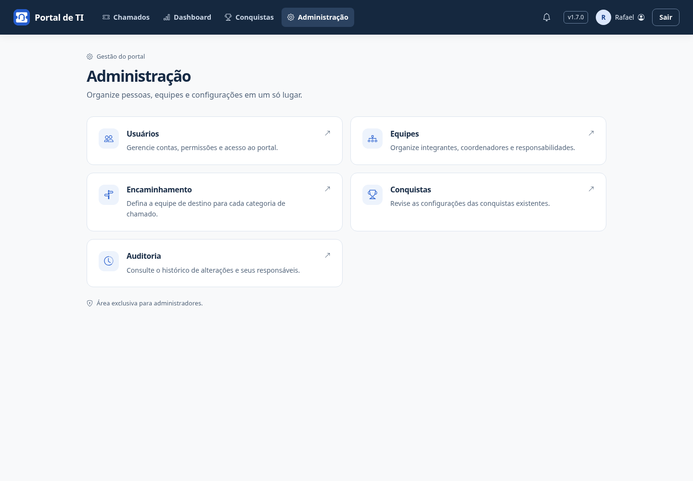
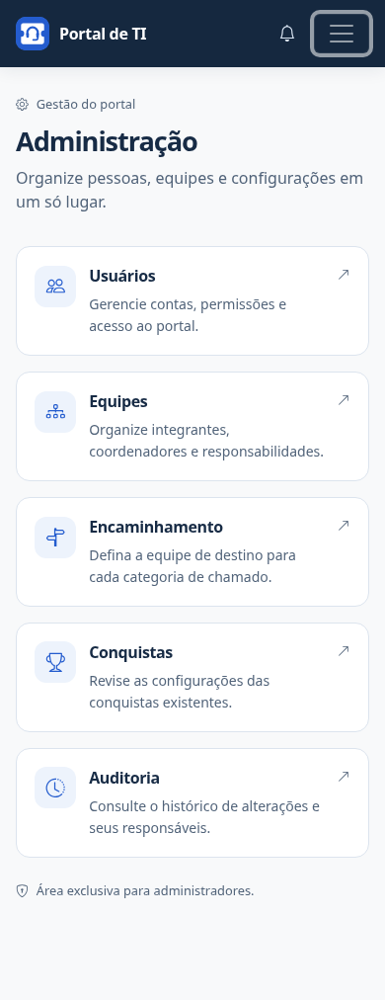

# Central de Administração

Administradores acessam **Administração** pelo ícone de engrenagem no cabeçalho. No celular, o acesso fica no menu de navegação. Ele substitui os links Gerenciar Usuários e Gerenciar Equipes.

A central reúne as ferramentas existentes:

| Área | Gestão |
| --- | --- |
| Usuários | Contas, permissões e ativação |
| Equipes | Integrantes, coordenadores e responsabilidades |
| Encaminhamento | Categoria do chamado → equipe de destino |
| Conquistas | Configurações das conquistas existentes |
| Auditoria | Consulta do histórico de alterações; sem edição ou exclusão |

As telas de gestão mantêm seus endereços e mostram um caminho de retorno à central. A seção Administração fica destacada durante a gestão; Conquistas no menu continua abrindo a coleção pessoal.

A central exige conta ativa com papel de administrador (superusuário), tanto no menu quanto na rota `/administracao/`. Técnicos, coordenadores e solicitantes não ganham permissões administrativas. A Auditoria abre a consulta protegida já existente no painel administrativo, exigindo também os requisitos de acesso desse painel. Os fluxos operacionais de coordenadores permanecem nos chamados.

A central apenas organiza a navegação. Não altera usuários, vínculos, regras ou registros de auditoria ao ser aberta. As alterações continuam nos formulários existentes, com suas validações e controles de acesso.

## Atualizar

Após backup e atualização do código aprovado, reinicie os processos e colete estáticos em produção. Não há nova migração ou dependência. A versão do código será exibida como 1.7.0; a publicação da Release é feita separadamente pelo workflow.

## Demonstração

Capturas da v1.7.0 com conta fictícia de demonstração.

