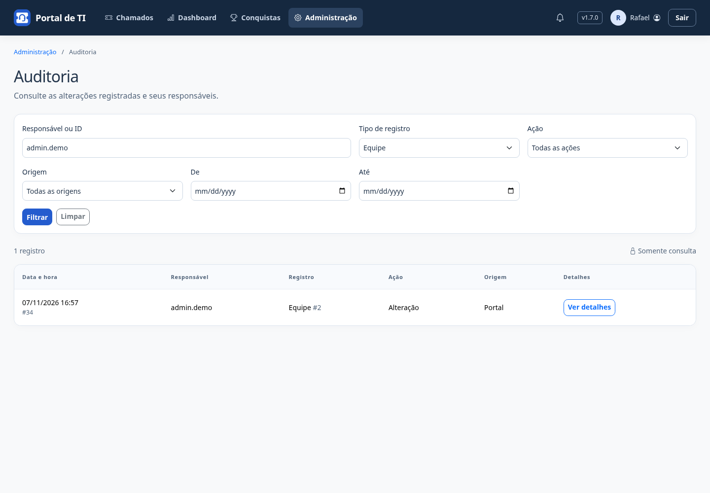
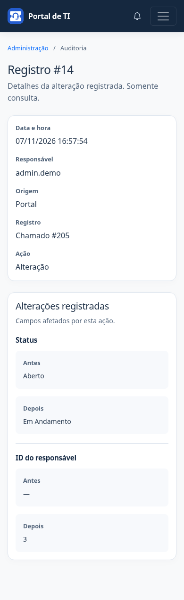
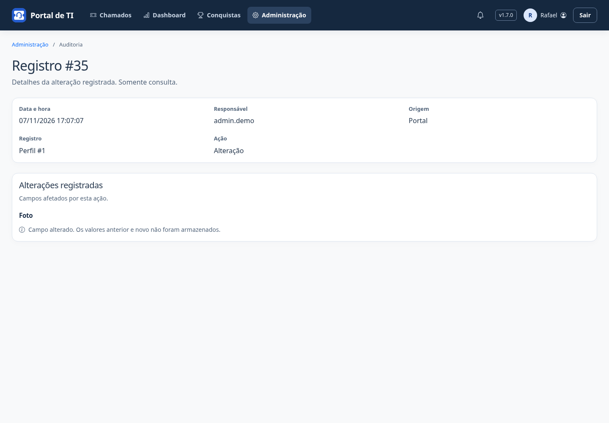

# Central de Administração

Administradores acessam **Administração** pelo ícone de engrenagem no cabeçalho. No celular, o acesso fica no menu de navegação. Ele substitui os links Gerenciar Usuários e Gerenciar Equipes.

A central reúne as ferramentas existentes:

| Área | Gestão |
| --- | --- |
| Usuários | Contas, permissões e ativação |
| Equipes | Integrantes, coordenadores e responsabilidades |
| Encaminhamento | Categoria do chamado → equipe de destino |
| Conquistas | Configurações das conquistas existentes |
| Respostas prontas | Criar, editar e desativar modelos para os técnicos |
| Auditoria | Histórico no próprio portal, com filtros e detalhes; sem edição ou exclusão |

As telas de gestão mantêm seus endereços e mostram um único caminho de retorno à central, pelo link Administração acima do conteúdo. Links antigos de volta a equipes, conquistas, regras e gerenciamento de usuários foram removidos dessas telas. A seção Administração fica destacada durante a gestão; Conquistas no menu continua abrindo a coleção pessoal.

A central exige conta ativa com papel de administrador (superusuário), tanto no menu quanto na rota `/administracao/`. Técnicos, coordenadores e solicitantes não ganham permissões administrativas. A Auditoria abre uma consulta dentro do próprio portal, com listagem paginada, filtros de período, responsável/ID, tipo, ação e origem, e detalhes de cada alteração. Somente administradores ativos podem consultar a lista e os registros por URL direta. Os fluxos operacionais de coordenadores permanecem nos chamados.

A central apenas organiza a navegação. Não altera usuários, vínculos, regras ou registros de auditoria ao ser aberta. As alterações continuam nos formulários existentes, com suas validações e controles de acesso.

## Atualizar

Após backup e atualização do código aprovado, reinicie os processos e colete estáticos em produção. A consulta de Administração não altera dados. Para a v1.10.0, aplique a migração 0026, que adiciona o catálogo de respostas prontas. A publicação da Release é feita separadamente pelo workflow.

## Demonstração

Capturas da v1.7.0 com conta fictícia de demonstração.

## Consulta de auditoria

Em Administração → Auditoria, filtre o período pelas datas inicial e final (inclusive), tipo de registro, ação e origem. A busca aceita o nome de usuário do responsável, ID do registro de auditoria ou ID do item alterado. Datas seguem o fuso horário configurado no portal. A lista mostra 20 registros por página, dos mais recentes para os mais antigos; filtros são preservados ao paginar. **Limpar** restaura a consulta completa. Filtros inválidos mostram erro, sem retornar uma lista ampla.

**Ver detalhes** mostra data, responsável, origem, item e alterações, com blocos Antes e Depois quando esses valores existem no histórico. Campos que registram apenas a mudança mostram uma mensagem única, sem colunas vazias. Campos cujo conteúdo não foi armazenado mostram apenas a alteração registrada; informações antigas não são reconstruídas. Registros sem responsável são identificados como Sistema.

O link Administração no topo é o único retorno. A consulta não permite criar, editar ou excluir registros e não produz novos eventos ao ser aberta. A consulta antiga do painel administrativo permanece protegida, mas não é mais o destino do card.

Capturas com histórico fictício de demonstração:

Veja [Respostas prontas](respostas-prontas.md) para administrar os modelos e entender quem pode usá-los nos chamados.
