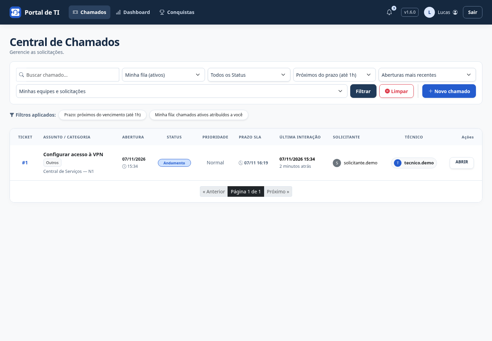
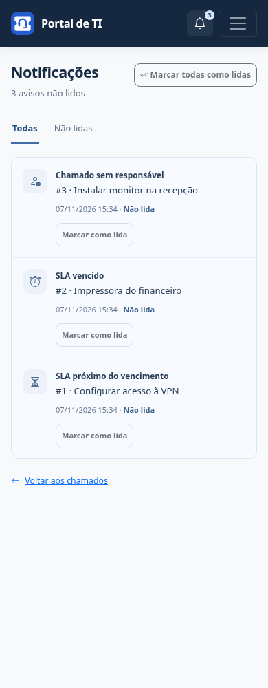

# Alertas de SLA

O portal verifica os chamados **Abertos e Em Andamento** de equipes ativas a cada minuto. Não depende de visitas à página e usa o vencimento calculado pelo portal. A antecedência é de **uma hora corrida**, mesmo que o cálculo original do SLA use horário comercial.

| Situação | Destinatário |
| --- | --- |
| Vencimento entre agora e uma hora | Técnico responsável ativo e integrante da equipe |
| Vencimento anterior a agora | Mesmo destinatário, com aviso de SLA vencido |
| Chamado sem responsável | Coordenadores ativos da equipe |
| Prazo próximo ou vencido sem responsável | Coordenadores ativos também recebem o aviso de prazo |

Sem coordenador elegível, o aviso aguarda uma próxima verificação. Contas sem papel de técnico, sem vínculo ou inativas não recebem. Resolvidos, Fechados e equipes inativas não geram avisos. Um chamado sem prazo pode gerar aviso de falta de responsável, mas não de SLA. Não há atribuição automática de técnico, mudança de prioridade ou envio de e-mail.

Os avisos aparecem no sino e na central já existentes. O contador atualiza ao navegar ou recarregar. Um prazo alcançado entre ciclos será identificado no ciclo seguinte; a antecedência é de até uma hora, não um agendamento no segundo exato.

## Evitar repetição

- Cada tipo de SLA é enviado uma vez por chamado, prazo e destinatário. Ler não libera novo aviso. O aviso de vencimento é uma situação diferente do aviso de proximidade.
- Alterar o prazo permite novos avisos para esse novo prazo. Um novo responsável também pode receber aviso; devolver ao mesmo técnico com o mesmo prazo não repete o mesmo tipo de SLA.
- Sem responsável, há um aviso por chamado, equipe, ciclo de atribuição e destinatário. Assumir e devolver à fila inicia um novo ciclo. Reenviar um formulário sem alterações não inicia outro ciclo.
- Unicidade no banco protege contra execução simultânea. As permissões atuais do chamado continuam sendo verificadas ao consultar ou abrir avisos.

A migração preserva avisos e datas de leitura. Não cria notificações; o primeiro processamento verifica **todos os chamados ativos elegíveis**, inclusive os já vencidos. Recomenda-se revisar a fila antes de iniciar. Não envia retrospectivamente as etapas de prazo que já passaram.

## Windows / desenvolvimento local

Com a `.venv` preparada e as migrações aplicadas, use um único terminal:

```powershell
.\iniciar-portal.cmd
```

O comando inicia portal e alertas. **Ctrl+C** encerra ambos. Não execute um segundo comando de alertas ao usar o inicializador. Veja [preparação do Windows](inicializacao-windows.md).

A execução manual continua disponível: `python manage.py runserver` e, em outro terminal com o mesmo banco/ambiente, `python manage.py processar_alertas_sla --continuo`. Para verificar uma vez, retire `--continuo`. `--intervalo 60` define a pausa entre ciclos, entre 5 e 3600 segundos. Falhas de banco no modo contínuo são registradas e tentadas novamente no próximo ciclo; na execução única, o comando termina com erro.

## Docker / homologação

O Compose inclui `alertas_sla`, com a mesma imagem, banco e usuário sem privilégios da aplicação, sem porta pública. Inicia após a saúde do app confirmar que as migrações terminaram e reinicia conforme a política do Compose. O healthcheck verifica uma execução bem-sucedida nos últimos três minutos; falhas persistentes deixam o serviço sem saúde e devem ser investigadas pelos logs.

```bash
docker compose --env-file .env.homologacao -f deploy/compose.yml up -d --build --wait
docker compose --env-file .env.homologacao -f deploy/compose.yml logs --tail=20 alertas_sla
```

Antes de migração, backup ou restauração, pare **app e alertas_sla**, além de qualquer outro escritor. Reinicie ambos depois. O comando de backup não detecta processos externos. Consulte [Homologação](homologacao.md).

## Filtros da fila

**Próximos do prazo (até 1h)** e **SLA vencido** combinam com Minha fila, busca, status, categoria, equipe e ordenação. Excluem finalizados e não ampliam o acesso. Selecionar um status finalizado com um filtro de prazo resulta em lista vazia. A seleção permanece na paginação; **Limpar** restaura a listagem padrão. Esses filtros funcionam mesmo sem o processo periódico, pois consultam o prazo diretamente.

## Demonstração

Capturas com dados fictícios da v1.6.0.




