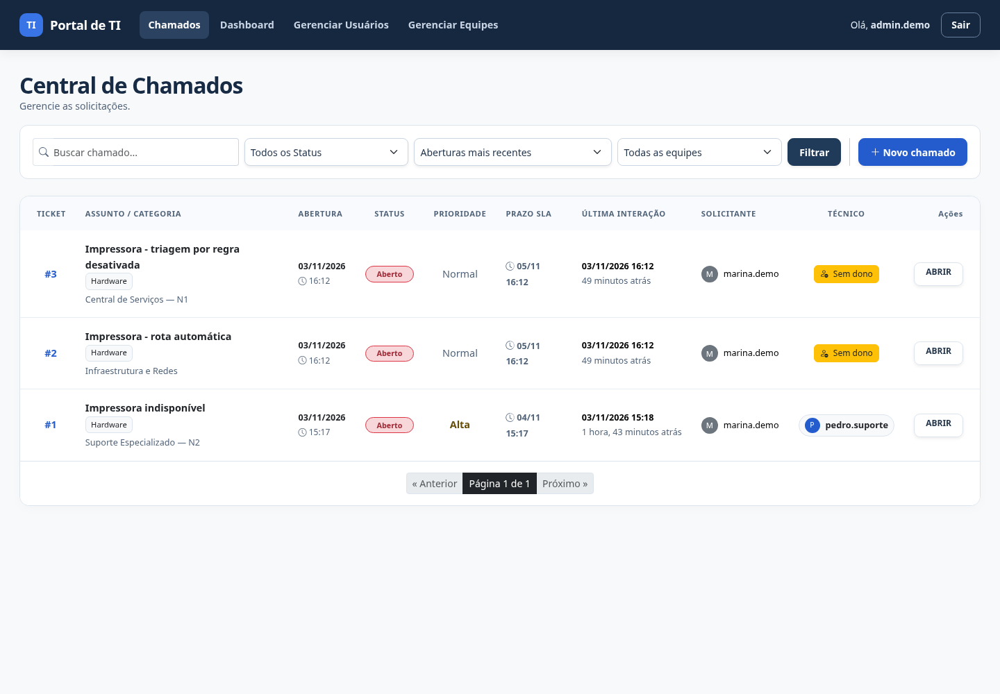
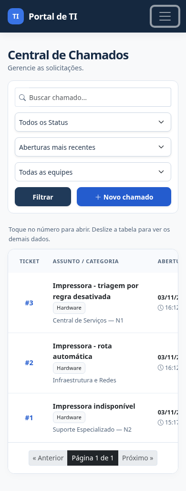

# Auditoria visual — preparação da v1.1.0

Revisão realizada em 03/11/2026, com dados fictícios. O escopo inclui fila, indicadores, abertura e detalhes do chamado, redistribuição, usuários, equipes, regras de encaminhamento e login.

## Achados e refinamentos

| Achado | Ajuste |
| --- | --- |
| Filtros competiam com o título e comprimiam a fila no desktop. | Painel próprio para busca e filtros, com campos distribuídos conforme o espaço disponível. |
| Menus duplicados tinham conteúdo e comportamento diferentes entre telas. | Componente compartilhado, página atual destacada e navegação recolhível também na gestão de equipes e nos formulários de usuários. |
| Tipografia, bordas, cores e espaçamentos variavam entre módulos. | Folha de estilos compartilhada, cabeçalho azul escuro, ações em azul, cartões e tabelas consistentes. |
| Alguns textos amarelos e ciano sobre branco eram difíceis de ler. | Tons mais escuros nos indicadores; estados continuam identificados por texto. |
| Algumas telas administrativas não declaravam viewport. | Viewport configurado para respeitar a largura do dispositivo. |
| Tabelas extensas exigem mais espaço que a tela de um celular. | Rolagem contida na tabela, região acessível por teclado e orientação explícita na fila. O número do chamado abre os detalhes sem exigir rolagem até a última coluna. |
| Cabeçalho de comentário ultrapassava a largura de celulares de 320px. | Autor e horário podem quebrar linha; recuos do histórico são menores no celular. |
| Campos e botões com ícone careciam de nomes acessíveis. | Rótulos associados aos campos e nome/estado atualizado nos botões de mostrar senha. |
| Não havia atalho para pular a navegação nem tratamento comum de movimento reduzido. | Link de salto, foco visível e respeito à preferência de reduzir animações. |
| Havia termos de português europeu e nomenclatura inconsistente. | Ajustes como “equipe”, “tela” e “Novo chamado”. |

As ações de negócio, os filtros e a visibilidade por perfil são preservados. Esta mudança não exige migração de banco de dados.

## Evidências

Capturas com dados fictícios; não contêm senhas ou informações de clientes.

## Validação

- Suíte existente: 189 testes aprovados.
- Verificação no Chromium em larguras de 1440, 768, 390 e 320 pixels, incluindo 13 telas autenticadas.
- Verificação do menu móvel, busca vazia, limpeza de filtros, link de salto por teclado, rótulos, botão de mostrar senha e visibilidade do menu de solicitante.
- Verificação de carregamento da folha de estilos e coleta de estáticos em configuração de produção.

A revisão não constitui certificação de acessibilidade. Uma próxima rodada pode incluir leitores de tela, Safari/iOS e pesquisa de usabilidade com técnicos e solicitantes. Bootstrap, ícones e gráficos continuam usando os CDNs já adotados pelo projeto.
