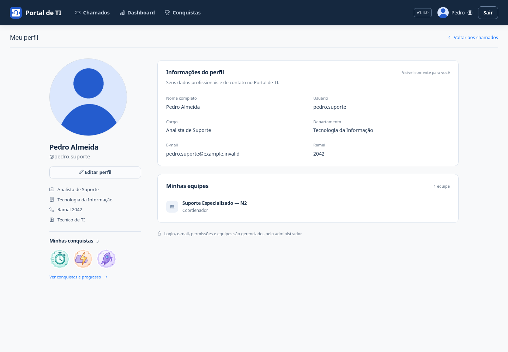
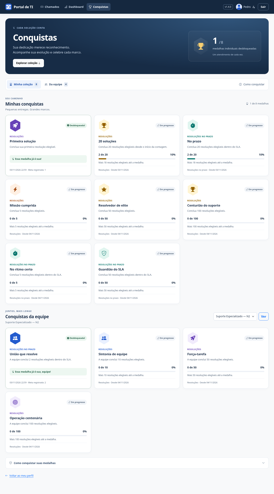
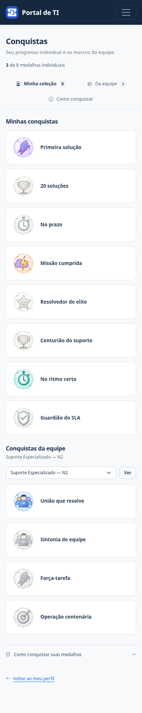
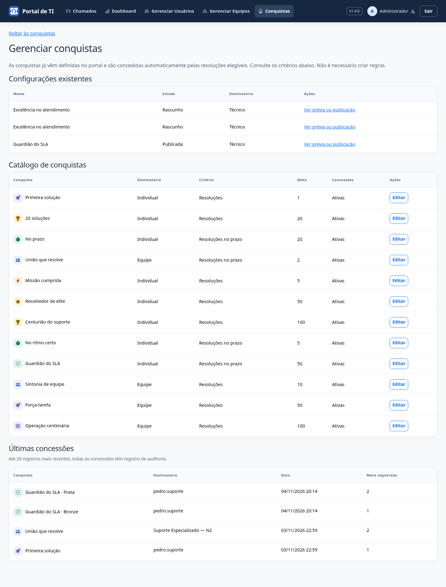

# Conquistas — v1.4.0

Acesse **Conquistas** para acompanhar o progresso individual e das equipes acessíveis. O cabeçalho resume as medalhas recebidas. Use os atalhos **Minha coleção**, **Da equipe** e **Como conquistar** para navegar; os critérios gerais ficam em um painel expansível. A coleção agrupa os níveis de cada conquista e aponta a próxima medalha. A visualização de **Meu Perfil** mostra todas as medalhas individuais do usuário, em miniaturas discretas de 60 px na lateral, abaixo dos dados profissionais. A edição dos dados e da foto fica em **Editar perfil**, separada da coleção. As oito ilustrações SVG são originais e servidas pelo portal. Selecione uma medalha para ver nome, descrição, meta registrada e data da concessão; os detalhes funcionam por toque, mouse e teclado, mesmo sem JavaScript. Na coleção, medalhas pendentes têm aparência discreta, além do estado em texto e do progresso; o encerramento avisa quando um novo nível é desbloqueado.

## Catálogo pronto para usar

As conquistas já vêm cadastradas. Não é necessário preencher formulários, criar regras ou publicar conquistas para começar: as resoluções elegíveis geram progresso automaticamente.

**Conquistas → Gerenciar conquistas** permite ao administrador consultar critérios e concessões. O botão de criação foi removido e o endereço antigo recusa GET e POST, inclusive para administradores.

As configurações criadas antes desta mudança permanecem acessíveis, com seus níveis e medalhas. Suas revisões continuam passando por prévia e confirmação; nenhuma configuração ou medalha é excluída. Trocar a aparência não concede medalhas. Pausas preservam o progresso, e retomadas exigem confirmação do impacto. Não é possível criar novas conquistas pelo portal.

## Conquistas predefinidas

O catálogo contém 12 conquistas. As metas abaixo são os valores iniciais; configurações administrativas anteriores são preservadas:

| Conquista | Destinatário | Meta inicial |
| --- | --- | --- |
| Primeira solução | Técnico | 1 resolução elegível |
| 20 soluções | Técnico | 20 resoluções elegíveis |
| No prazo | Técnico | 20 resoluções dentro do SLA |
| União que resolve | Equipe | 20 resoluções dentro do SLA |
| Missão cumprida | Técnico | 5 resoluções elegíveis |
| Resolvedor de elite | Técnico | 50 resoluções elegíveis |
| Centurião do suporte | Técnico | 100 resoluções elegíveis |
| No ritmo certo | Técnico | 5 resoluções dentro do SLA |
| Guardião do SLA | Técnico | 50 resoluções dentro do SLA |
| Sintonia de equipe | Equipe | 10 resoluções elegíveis |
| Força-tarefa | Equipe | 50 resoluções elegíveis |
| Operação centenária | Equipe | 100 resoluções elegíveis |

A migração **0022** adiciona as oito novas conquistas, cada uma com ícone próprio escolhido do catálogo visual. A contagem dessas conquistas começa na aplicação da migração. Eventos anteriores não geram progresso nem medalhas para elas. As quatro regras anteriores mantêm suas metas, datas, ícones e histórico. A atualização é aditiva e não concede medalhas durante a migração.

Nessas regras, mudar a meta ou reativar concessões salva uma **proposta de revisão**: a regra atual só muda após a prévia e a confirmação. Alterações apenas de aparência e pausas são aplicadas sem conceder medalhas. Uma revisão antiga não pode sobrescrever uma regra alterada por outra pessoa; revise o rascunho novamente.

A migração **0021** adiciona planos e níveis sem modificar as regras, as datas ou as medalhas anteriores. As medalhas preservam nome, descrição, ícone, meta, nível e versão no momento da concessão. Cada nível concede uma única medalha por destinatário, sem repetição a cada nova meta. Pausar ou mudar uma regra não revoga medalhas.

## O que conta

- Encerramento pela ação do portal, com solução validada, por técnico ativo responsável e integrante da equipe ativa.
- O solicitante deve ser outra pessoa; chamados próprios não contam.
- Cada chamado contribui uma vez. Comentários, atribuições, transferências e alterações pelo ORM/Admin não geram progresso.
- O crédito pertence ao técnico e à equipe no encerramento.
- Dentro do SLA significa encerramento menor ou igual ao prazo registrado. Sem prazo, a resolução não conta como pontual.
- Só há eventos desde a instalação das conquistas. Chamados abertos antes podem contar se encerrados depois.

Não há avaliação de satisfação, pontuação geral, conquistas mensais ou métricas arbitrárias. Quantidade de resoluções não representa, sozinha, qualidade de atendimento.

## Acesso e integridade

O técnico vê seu progresso individual e as equipes acessíveis; solicitantes não consultam dados de equipes. A medalha coletiva pertence à equipe, e não permanentemente a seus antigos integrantes. Medalhas individuais permanecem com o usuário mesmo que ele mude de equipe.

Mudanças e concessões são auditadas. Formulários antigos são recusados pelo controle de versão. Regras, planos, eventos e medalhas são somente consultáveis no Django Admin, sem edição ou concessão manual. O registro do evento e as medalhas integram a transação do encerramento: falhas revertem toda a operação.

Faça backup, atualize o código, aplique `python manage.py migrate`, colete estáticos em produção e reinicie. O backup inclui planos, níveis, eventos e medalhas; a homologação verifica a restauração em destino separado. [Notas da v1.4.0](releases/v1.4.0.md).

## Vitrine no perfil

As medalhas exibidas pertencem somente ao usuário autenticado; a vitrine não transforma o perfil em uma página pública. A apresentação preserva os metadados da concessão, mesmo após alterações na regra.

## Demonstração

Capturas com contas e dados fictícios; metas reduzidas apenas para demonstrar a evolução.

