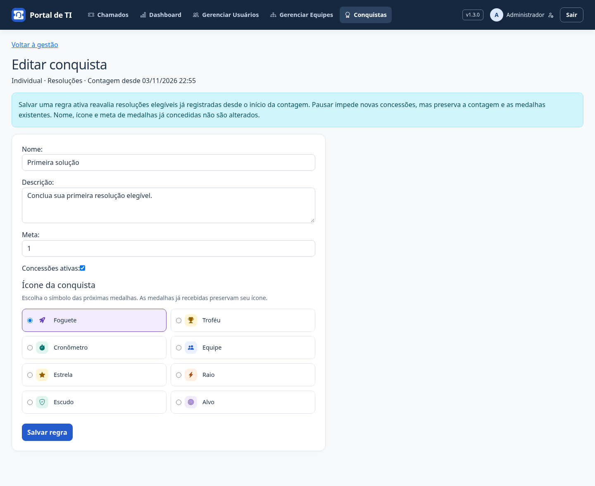

# Conquistas — v1.3.0

O sistema reconhece resoluções de técnicos e resultados coletivos, sem pontuação geral ou novo ranking. Acesse **Conquistas** no menu para consultar suas medalhas, o progresso individual e o de uma equipe à qual você tem acesso. O perfil apresenta até três medalhas individuais recentes. Um aviso aparece para quem encerra o chamado quando uma conquista é desbloqueada.

## Catálogo inicial

| Conquista | Destinatário | Critério inicial |
| --- | --- | --- |
| Primeira solução | Técnico | 1 resolução elegível |
| 20 soluções | Técnico | 20 resoluções elegíveis |
| No prazo | Técnico | 20 resoluções elegíveis dentro do SLA |
| União que resolve | Equipe | 20 resoluções elegíveis dentro do SLA |

As metas são acumuladas, sem janela mensal ou percentual de SLA. O administrador pode alterar nome, descrição, meta (1–100.000) e ativação; deve ajustar o texto quando mudar uma meta numérica. O catálogo inicial não permite criar métricas arbitrárias ou excluir regras pela interface.

## O que conta

- Encerramento pela ação do portal, com solução validada, por técnico ativo que é responsável e integrante da equipe ativa.
- O solicitante precisa ser outra pessoa. Chamados abertos pelo próprio técnico não contam.
- Cada chamado contribui uma vez. Comentários, atribuições, transferências e mudanças pelo ORM/Django Admin não geram progresso.
- O crédito pertence ao técnico e à equipe no encerramento. Transferir um chamado antes da conclusão não premia a equipe de origem.
- Dentro do SLA significa data de encerramento menor ou igual ao prazo registrado no chamado; sem prazo, a resolução não conta como pontual.
- Só há progresso por eventos registrados a partir da instalação da funcionalidade. A migração não analisa chamados já resolvidos. Chamados abertos antes da instalação podem contar quando encerrados depois dela.

Não há avaliação de satisfação, artigos ou participação entre equipes nesta versão. Cumprir uma quantidade de resoluções não é uma avaliação completa de qualidade do atendimento.

## Administração e histórico

Somente administradores acessam **Conquistas → Gerenciar conquistas**. A página mostra as quatro regras e até 20 concessões recentes. Regras, eventos e medalhas também são consultáveis no Django Admin, sem edição ou concessão manual por lá.

Salvar uma regra ativa reavalia os eventos elegíveis já registrados desde o início de sua contagem; reduzir a meta ou reativar uma regra pode conceder medalhas imediatamente. Pausar impede novas concessões, mas o registro de resoluções continua. Abrir páginas por GET não concede medalhas ou altera dados.

Cada medalha é única por regra e pessoa/equipe. Ela preserva nome, descrição, ícone, meta e versão da regra no momento da concessão. Editar uma regra não revoga nem reescreve medalhas anteriores; a conquista não é repetível a cada nova meta. Mudanças e concessões geram auditoria. O controle de versão evita salvar formulários administrativos antigos sobre regras alteradas por outra pessoa.

O técnico vê apenas seu progresso individual e o das equipes acessíveis. Solicitantes não veem dados de equipes; administradores podem consultar todas. Uma medalha coletiva pertence à equipe, não a uma lista permanente de seus antigos integrantes. A vitrine individual permanece com o usuário mesmo se ele mudar de equipe.

## Instalação e integridade

Faça backup, atualize o código, execute `python manage.py migrate` (0019), colete estáticos em produção e reinicie. A migração cria regras com início da contagem no instante da aplicação e não altera contas, equipes ou chamados. Os novos dados entram no backup SQLite existente; a homologação verifica a restauração de evento e medalha.

O registro do evento e as concessões integram a transação de encerramento. Se a gravação ou auditoria falhar, o encerramento e suas medalhas são revertidos. Uma nova tentativa não duplica o crédito do chamado.

A v1.3.0 só se torna uma publicação oficial após merge, validação e execução de **Publicar versão** na main. A tag v1.2.0 não é alterada.

## Demonstração

Capturas com dados fictícios. A meta coletiva foi ajustada para 2 apenas na demonstração, para ilustrar a concessão; a configuração inicial é 20.

## Identidade das medalhas

As conquistas têm medalhas com fitas, cores próprias e ícones diferentes: foguete na Primeira solução, troféu em 20 soluções, cronômetro em No prazo e equipe em União que resolve. O resumo da coleção mostra quantas medalhas individuais foram desbloqueadas; as conquistas coletivas aparecem separadas.

Em **Gerenciar conquistas → Editar**, o administrador escolhe entre oito símbolos: foguete, troféu, cronômetro, equipe, estrela, raio, escudo e alvo. A escolha usa um catálogo fechado, sem upload de arquivos ou classes livres. Os controles são utilizáveis por teclado, e os estados são identificados por texto, além de cor.

A migração **0020** atribui os ícones iniciais às regras e medalhas existentes sem alterar datas, nomes, metas, versão dos critérios, contagem ou concessões. Depois da migração, trocar o ícone de uma regra afeta apenas medalhas futuras; medalhas recebidas preservam seu símbolo.

