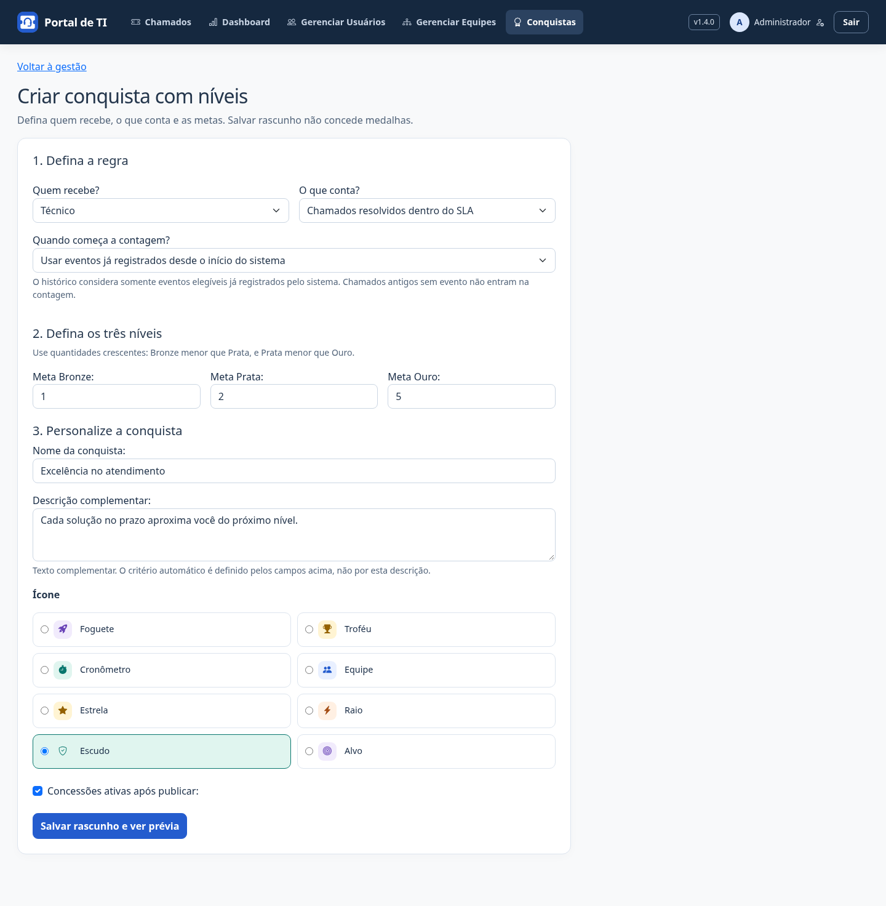
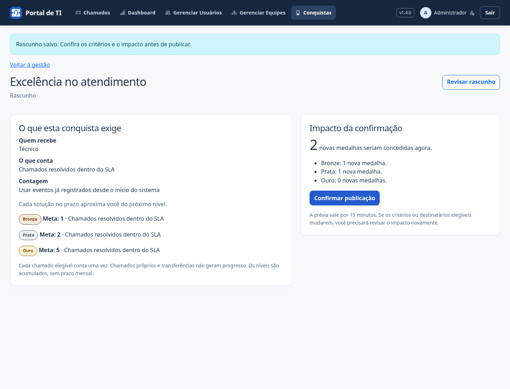

# Conquistas — v1.4.0

Acesse **Conquistas** para acompanhar o progresso individual e das equipes acessíveis. A coleção agrupa os níveis de cada conquista e aponta a próxima medalha. O perfil mostra até três medalhas individuais recentes; o encerramento avisa quando um novo nível é desbloqueado.

## Criar uma conquista

Somente administradores acessam **Conquistas → Gerenciar conquistas → Criar conquista**.

1. **Defina a regra:** quem recebe (técnico ou equipe), o que conta (resoluções elegíveis ou dentro do SLA) e quando começa a contagem.
2. **Defina as metas:** Bronze, Prata e Ouro com números crescentes entre 1 e 100.000. Exemplo: 5, 20 e 50 resoluções dentro do SLA. As metas são acumuladas, sem janela mensal.
3. **Personalize:** nome, descrição e um dos oito símbolos. A descrição explica a conquista; o critério é determinado pelos campos anteriores.
4. **Salve o rascunho:** isso não cria medalhas nem altera regras publicadas.
5. **Confira a prévia:** ela mostra os critérios e quantas novas medalhas cada nível concederia. Confirme somente após revisar o impacto.

**A partir da publicação** começa do zero, sem eventos anteriores. **Incluir eventos elegíveis já registrados** usa o histórico desde a instalação das conquistas: chamados antigos sem evento não são analisados nem convertidos em progresso.

A confirmação assinada vale por 15 minutos. Se o rascunho, a regra original ou os destinatários elegíveis mudarem, a publicação exige uma nova revisão. Repetir uma publicação concluída não duplica medalhas. Abrir páginas nunca concede medalhas.

## Após publicar

- **Editar aparência:** muda nome, descrição e ícone para futuras medalhas, sem reavaliar progresso nem reescrever as recebidas.
- **Pausar concessões:** preserva medalhas e início da contagem. Os eventos de resolução continuam sendo registrados.
- **Retomar:** exige revisar e confirmar o impacto das resoluções acumuladas durante a pausa.
- **Mudar critérios ou metas de uma nova conquista:** crie outra conquista. A regra publicada permanece fixa, preservando o significado das medalhas.

Uma conquista pode ser publicada pausada. Seus níveis ficam disponíveis sem concessões até a retomada confirmada.

## Catálogo anterior e migração

As quatro conquistas da v1.3.0 continuam independentes, sem conversão automática em níveis:

| Conquista | Destinatário | Meta inicial |
| --- | --- | --- |
| Primeira solução | Técnico | 1 resolução elegível |
| 20 soluções | Técnico | 20 resoluções elegíveis |
| No prazo | Técnico | 20 resoluções dentro do SLA |
| União que resolve | Equipe | 20 resoluções dentro do SLA |

Nessas regras, mudar a meta ou reativar concessões salva uma **proposta de revisão**: a regra atual só muda após a prévia e a confirmação. Alterações apenas de aparência e pausas são aplicadas sem conceder medalhas. Uma revisão antiga não pode sobrescrever uma regra alterada por outra pessoa; revise o rascunho novamente.

A migração **0021** adiciona planos e níveis sem modificar as regras, as datas ou as medalhas anteriores. As medalhas preservam nome, descrição, ícone, meta, nível e versão no momento da concessão. Cada nível concede uma única medalha por destinatário, sem repetição a cada nova meta. Pausar ou mudar uma regra não revoga medalhas.

## O que conta

- Encerramento pela ação do portal, com solução validada, por técnico ativo responsável e integrante da equipe ativa.
- O solicitante deve ser outra pessoa; chamados próprios não contam.
- Cada chamado contribui uma vez. Comentários, atribuições, transferências e alterações pelo ORM/Admin não geram progresso.
- O crédito pertence ao técnico e à equipe no encerramento.
- Dentro do SLA significa encerramento menor ou igual ao prazo registrado. Sem prazo, a resolução não conta como pontual.
- Só há eventos desde a instalação das conquistas. Chamados abertos antes podem contar se encerrados depois.

Não há avaliação de satisfação, pontuação geral, conquistas mensais ou métricas arbitrárias. Quantidade de resoluções não representa, sozinha, qualidade de atendimento.

## Acesso e integridade

O técnico vê seu progresso individual e as equipes acessíveis; solicitantes não consultam dados de equipes. A medalha coletiva pertence à equipe, e não permanentemente a seus antigos integrantes. Medalhas individuais permanecem com o usuário mesmo que ele mude de equipe.

Mudanças e concessões são auditadas. Formulários antigos são recusados pelo controle de versão. Regras, planos, eventos e medalhas são somente consultáveis no Django Admin, sem edição ou concessão manual. O registro do evento e as medalhas integram a transação do encerramento: falhas revertem toda a operação.

Faça backup, atualize o código, aplique `python manage.py migrate`, colete estáticos em produção e reinicie. O backup inclui planos, níveis, eventos e medalhas; a homologação verifica a restauração em destino separado. [Notas da v1.4.0](releases/v1.4.0.md).

## Demonstração

Capturas com contas e dados fictícios; metas reduzidas apenas para demonstrar a evolução.

