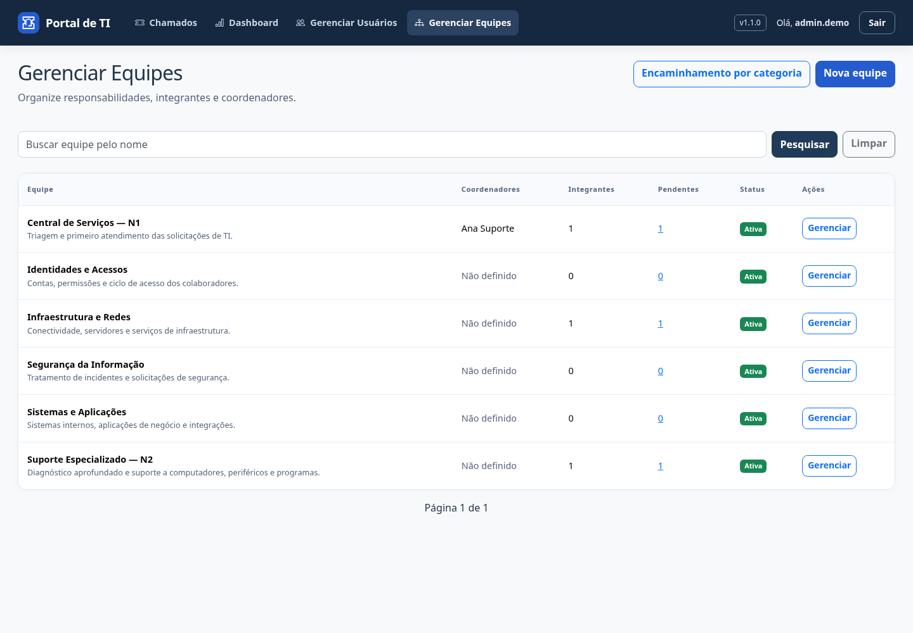
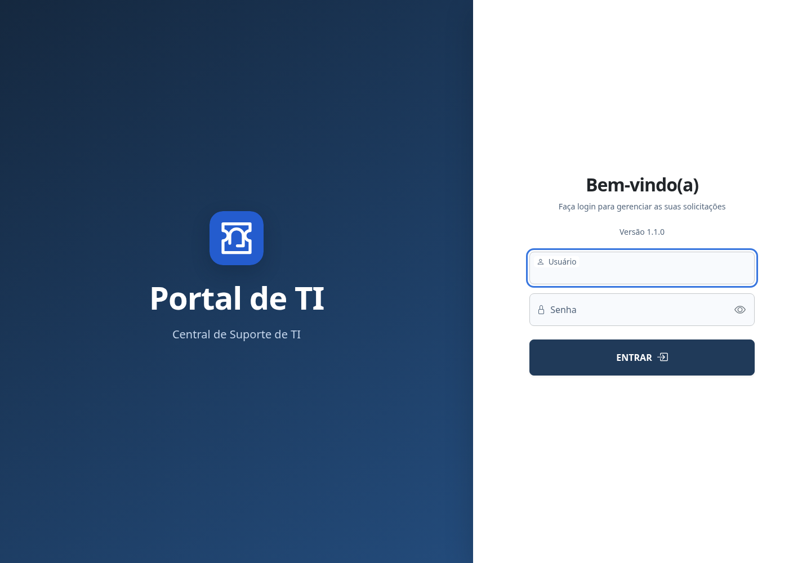

# Identidade visual — Portal de TI

O Portal de TI tem marca própria, independente de empresas que o utilizem. O nome exibido é **Portal de TI** e o descritor é **Central de suporte**.

## Símbolo e uso

O contorno de um chamado representa a solicitação; o headset representa o atendimento. O símbolo é branco sobre azul, com cantos arredondados. A versão compacta é usada no cabeçalho e na aba do navegador; a assinatura com nome e descritor é indicada para documentação e apresentação.

Os arquivos vetoriais estão em `helpdesk/static/helpdesk/brand/`: `simbolo.svg` e `logo.svg`. O favicon PNG de 32px atende navegadores sem ícone SVG, e o ícone de 180px atende atalhos em dispositivos Apple. As declarações ficam no componente compartilhado `estilos.html` para contemplar também equipes e regras.

Mantenha as proporções, a legibilidade e uma área livre de pelo menos um quarto da altura do símbolo. Não use sombras ou cores de status no símbolo. No cabeçalho, o texto do nome identifica a marca; o ícone ao lado é decorativo para leitores de tela.

## Paleta

| Uso | Cor |
| --- | --- |
| Navegação e base da marca | `#15283F` |
| Marca e ações principais | `#245CCE` |
| Texto principal | `#172B45` |
| Texto secundário | `#52647A` |
| Fundo | `#F4F7FB` |
| Superfícies | `#FFFFFF` |
| Bordas | `#DCE4EE` |

Vermelho, verde e amarelo continuam reservados para estados de atendimento e avisos, sempre acompanhados de texto. Os ícones do menu pertencem à família Bootstrap Icons; equipes usam `bi-diagram-3` e usuários, `bi-people`.

## Tipografia e componentes

Use Segoe UI com fallback para a fonte do sistema, sem dependência de fontes externas. Títulos têm peso forte e texto de apoio discreto. Cartões usam raio de 14px; campos e botões, aproximadamente 8px. A ação principal de cada contexto usa azul; ações secundárias usam contorno ou fundo neutro.

Mantenha foco por teclado visível, rótulos explícitos e respeito à preferência de movimento reduzido. No celular, recolha a navegação e permita rolagem contida nas tabelas. Consulte `docs/auditoria-visual.md` para a revisão anterior.

## Aplicação no portal

Capturas com dados fictícios de demonstração:

