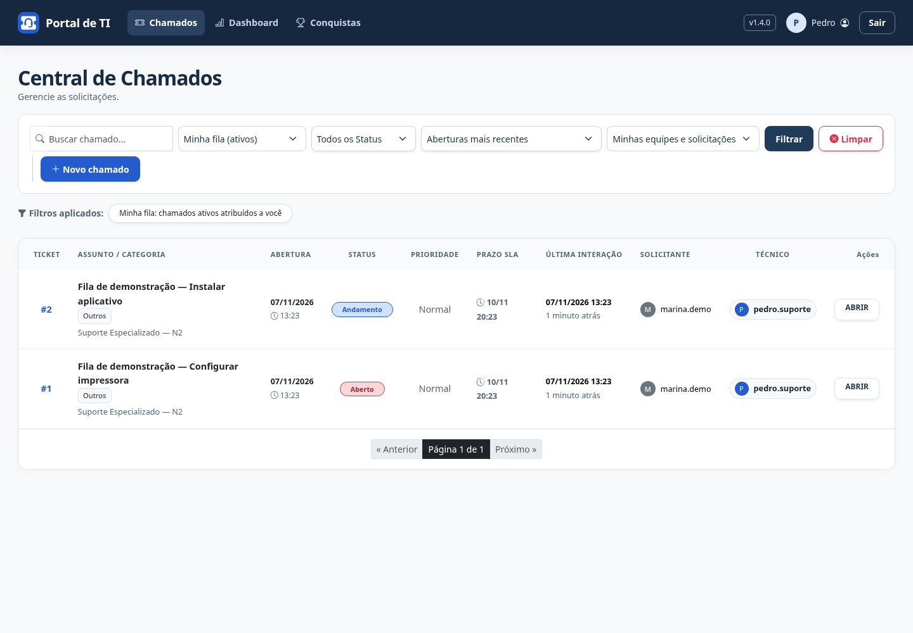

# Minha fila

Na Central de Chamados, técnicos e administradores podem escolher **Minha fila (ativos)** no filtro de fila e clicar em **Filtrar**.

A lista mostra somente chamados atribuídos à conta conectada e que ainda não estão Resolvidos ou Fechados. Chamados sem responsável ou atribuídos a outros técnicos não entram. As permissões das equipes continuam sendo respeitadas.

O filtro combina com busca, status, categoria, equipe e ordenação. Ele permanece ao trocar de página. **Limpar** volta à listagem padrão; também é possível selecionar **Todas as filas acessíveis**.

Escolher um status finalizado junto de Minha fila retorna uma lista vazia, pois a fila contém apenas atendimentos ativos. Clientes continuam acompanhando suas solicitações e não recebem esse seletor de atendimento.

A alteração não exige migração. Atualize o código e reinicie a aplicação.

## Demonstração

Captura com dados fictícios e dois chamados ativos atribuídos ao técnico conectado.

