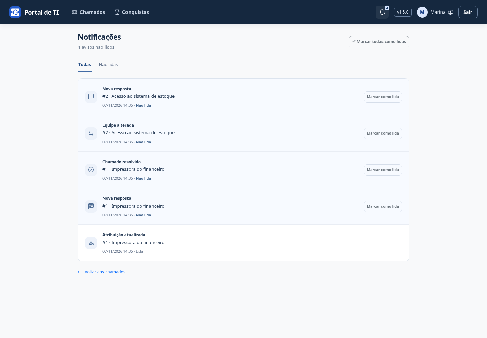
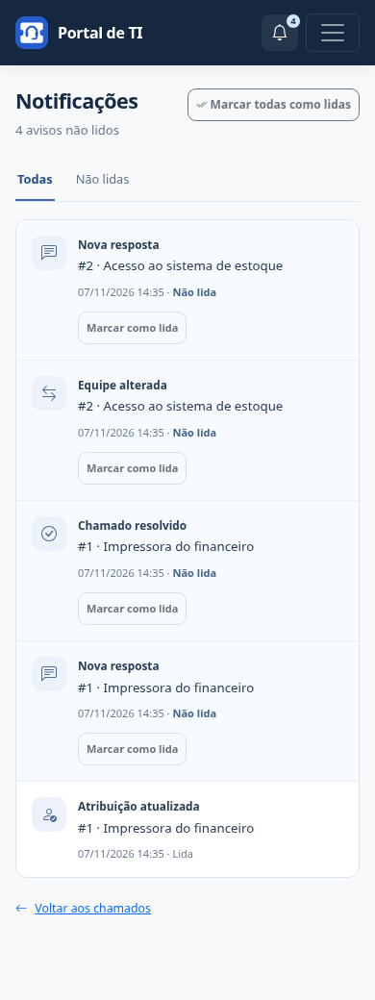

# Notificações

O sino no cabeçalho abre **Notificações**. Ele mostra a quantidade de avisos pessoais não lidos; acima de 99, o indicador visual exibe **99+**, e o nome acessível mantém a quantidade completa. O sino também fica disponível no cabeçalho móvel, sem abrir o menu.

## Quando um aviso é enviado

| Evento | Destinatários envolvidos |
| --- | --- |
| Atribuição ou devolução à fila | Solicitante, responsável atual e anterior, quando ainda têm acesso. Sem responsável, coordenadores ativos da equipe são incluídos. |
| Nova resposta | Solicitante e responsável atual. Sem responsável, coordenadores ativos da equipe. |
| Transferência de equipe | Participantes acima, considerando o destino. O responsável anterior só recebe se ainda tiver acesso. |
| Resolução | Solicitante e responsável atual. |

A pessoa que realizou a ação e contas inativas são excluídas. Outros técnicos e administradores não envolvidos não recebem cópias gerais. Uma solução gera somente o aviso de resolução, sem aviso de resposta duplicado. Novos chamados ainda sem interação não geram aviso nesta etapa.

Somente ações bem-sucedidas pelos fluxos do portal geram notificações. Edições diretas no ORM/Admin, GETs, formulários inválidos e conflitos de atribuição não geram avisos. A migração não analisa o histórico para criar notificações antigas.

## Ler e acompanhar

- **Todas / Não lidas:** alterna a lista, com 20 avisos por página, dos mais recentes para os mais antigos.
- **Clique no aviso:** marca como lido e abre o chamado correspondente.
- **Marcar como lida:** registra a leitura sem abrir o chamado.
- **Marcar todas como lidas:** afeta somente avisos atualmente acessíveis da própria conta.

Abrir a central ou abrir o chamado por outro caminho não marca os avisos. Repetir uma marcação preserva a primeira data de leitura. Não há exclusão ou envio por e-mail nesta etapa. Lista e contador são atualizados ao navegar/recarregar, sem polling ou serviço externo.

## Acesso e integridade

Cada consulta combina o destinatário autenticado com as permissões atuais do chamado. Se um técnico perde vínculo, papel ou acesso após uma transferência, esses avisos deixam de aparecer, inclusive no contador, e não podem ser marcados nem abertos pelo ID. O solicitante mantém acesso aos próprios chamados conforme as regras do portal.

As notificações não guardam cópias de comentários, soluções ou títulos: o título é carregado somente de chamados acessíveis. A identidade do destinatário nunca é escolhida pelo navegador. Abrir e marcar leitura exigem POST com CSRF; GET não altera dados. Os dados também são somente consultáveis no Django Admin por administradores.

Os avisos integram a transação da ação do chamado. Falhas revertem a ação e seus avisos juntos. Uma chave de evento e destinatário impede duplicação do mesmo evento persistido; duas respostas realmente gravadas são eventos diferentes.

## Atualização

Faça backup, atualize o código, execute `python manage.py migrate` para aplicar a **0023**, colete estáticos em produção e reinicie. As notificações e datas de leitura ficam no banco SQLite e são incluídas no backup/restauração existente. Não há nova dependência ou credencial externa.

