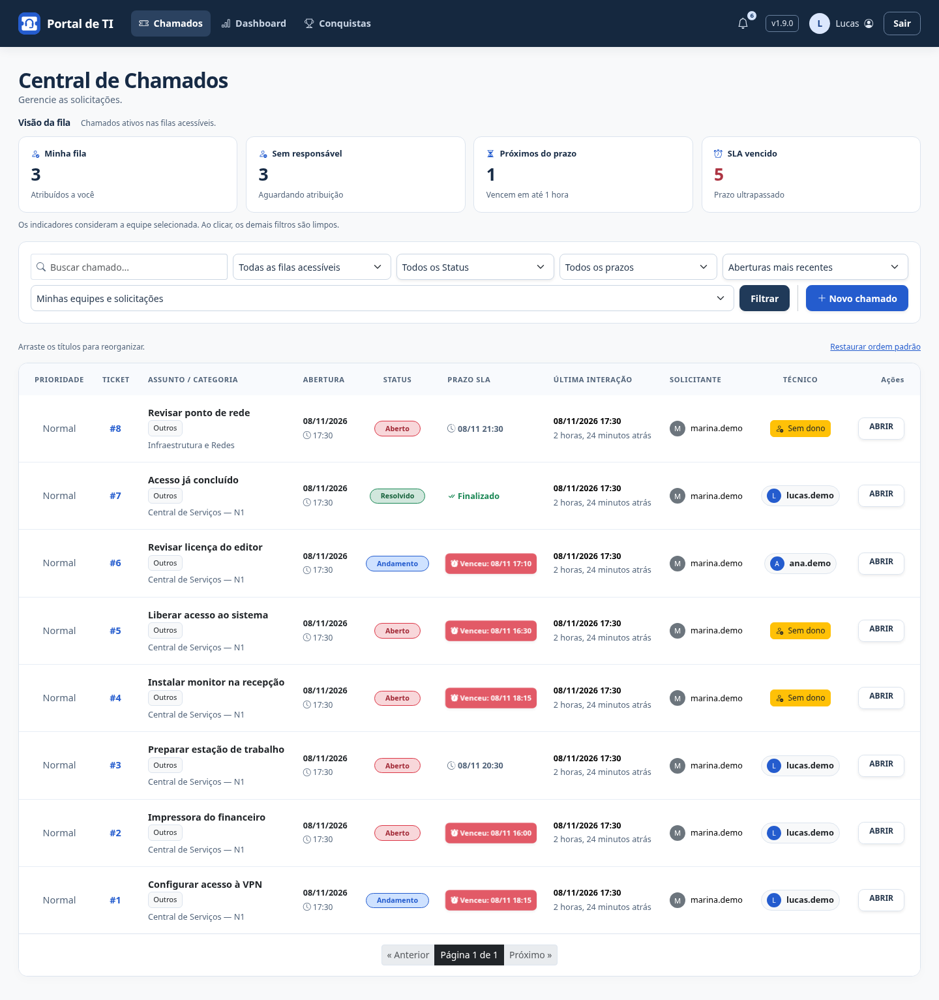
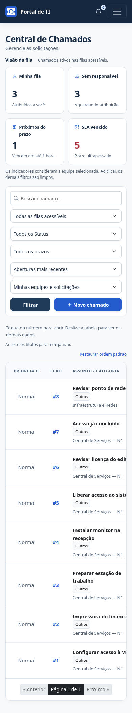

# Ordem pessoal das colunas

Na Central de Chamados, passe o mouse sobre um título da tabela para ver o indicador de movimento. Arraste e solte na posição desejada. A coluna inteira acompanha o título e a nova sequência é salva automaticamente na sua conta.

Todas as dez colunas podem ser movidas; nenhuma é ocultada. A mudança organiza a apresentação e não altera a ordenação dos chamados ou as permissões de acesso.

- **Mouse:** clique e arraste o título. Solte para concluir.
- **Celular:** mantenha o dedo sobre o título por um instante e arraste horizontalmente. Para consultar dados mais à direita sem reorganizar, deslize o corpo da tabela.
- **Teclado:** use Tab para focar um título; Alt + seta para a esquerda/direita move a coluna. A ordem é salva a cada movimento.
- **Cancelar:** Esc cancela um arraste em andamento. Cancelamento de toque ou saída da janela também desfaz esse movimento.
- **Restaurar ordem padrão:** o comando discreto acima da tabela restaura e salva a sequência original.

A sequência permanece ao filtrar, paginar, fechar o navegador e entrar novamente na mesma instalação. Cada conta tem sua preferência. Em acessos simultâneos, vale a última gravação recebida pelo servidor. Uma instalação com banco independente tem suas próprias preferências.

O estado “Ordem salva” aparece somente depois da confirmação do servidor. Se a gravação falhar, a organização continua visível na página e aparece **Tentar salvar novamente**. Use essa opção antes de recarregar ou sair para não perder o ajuste ainda não salvo.

A personalização também funciona com a tabela vazia. Abrir a página não grava dados; contas sem preferência usam a ordem padrão. Sem JavaScript, a tabela continua disponível na sequência padrão.

## Atualização

Pare portal e alertas, faça backup de banco e uploads, atualize a main aprovada e aplique a migração **0025**:

```powershell
.\.venv\Scripts\python.exe manage.py migrate
.\iniciar-portal.cmd
```

Em produção, colete estáticos e reinicie os serviços. O inicializador do Windows verifica migrações pendentes antes de iniciar.

A tabela de preferências tem vínculo único com o usuário e integra o backup SQLite existente. A migração não cria preferências para contas antigas e não altera chamados, perfis ou auditoria.

## Demonstração

Capturas com dados fictícios e a coluna Prioridade movida para o início.




