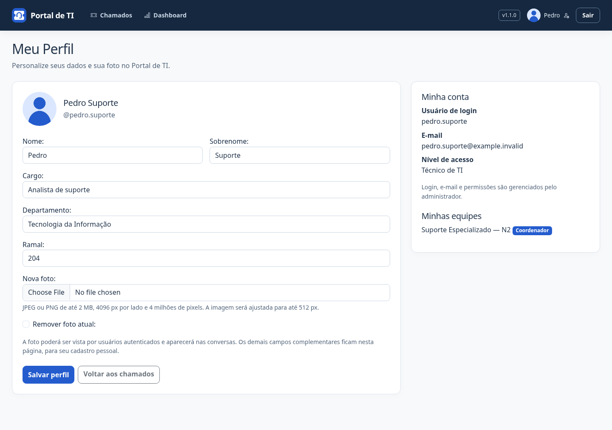

# Meu Perfil — preparação da v1.2.0

Usuários autenticados acessam **Meu Perfil** pelo nome ou avatar no canto superior direito. Podem editar nome, sobrenome, cargo, departamento e ramal, além de incluir, trocar ou remover sua foto.

Login, e-mail, senha, permissões e vínculos com equipes não são alterados por esse formulário. Equipes e papéis continuam sob administração; vínculos existentes aparecem somente para consulta. O mesmo formulário atende contas locais e contas autenticadas por Google SSO.

## Fotos e privacidade

- JPEG ou PNG não animado, até 2 MB, 4096 pixels por lado e 4 milhões de pixels no total.
- Decodificação completa com Pillow, correção de orientação, redução para até 512 × 512 pixels e nova codificação em PNG sem metadados do upload.
- Nome aleatório sob `MEDIA_ROOT/perfis/`. Não há publicação direta de `/media/`.
- Fotos de contas ativas podem ser vistas por outros usuários autenticados, por uma rota que retorna somente a imagem normalizada, com cache privado desabilitado. Cargo, departamento e ramal ficam na página do próprio usuário.
- Cabeçalho e mensagens usam a foto atual; sem foto, mostram a inicial. A alteração da foto não altera o conteúdo ou a autoria de comentários históricos.

Trocas e remoções excluem o arquivo anterior somente após a confirmação da transação. Em falhas de gravação/auditoria, o arquivo novo é removido e a foto anterior é preservada. A limpeza de arquivos antigos é uma operação posterior ao commit: uma falha de armazenamento pode deixar um arquivo sem referência, sem reverter os dados salvos.

As alterações são auditadas com indicação dos campos alterados, sem copiar nomes, cargo, ramal ou conteúdo da foto para a auditoria. O controle de versão impede que um formulário antigo sobrescreva uma edição mais recente.

## Atualização e backup

Instale `requirements.txt`, execute `python manage.py migrate`, colete estáticos em produção e reinicie a aplicação. A migração 0017 cria a tabela de perfis sem modificar chamados ou permissões. O perfil é criado na primeira edição válida; abrir a página não cria registros. Contas existentes e contas novas usam iniciais até cadastrarem uma foto.

Os backups passam a conferir também os caminhos de fotos referenciados no banco. Backups antigos, anteriores à tabela de perfis, continuam aceitos. Pare escritores conforme as instruções de operação antes de copiar banco e arquivos.

Esta entrega prepara a v1.2.0. Não publica uma nova tag ou Release nem altera a tag v1.1.0.

## Tela de demonstração

Dados fictícios e avatar ilustrativo, sem fotografia de uma pessoa real:

