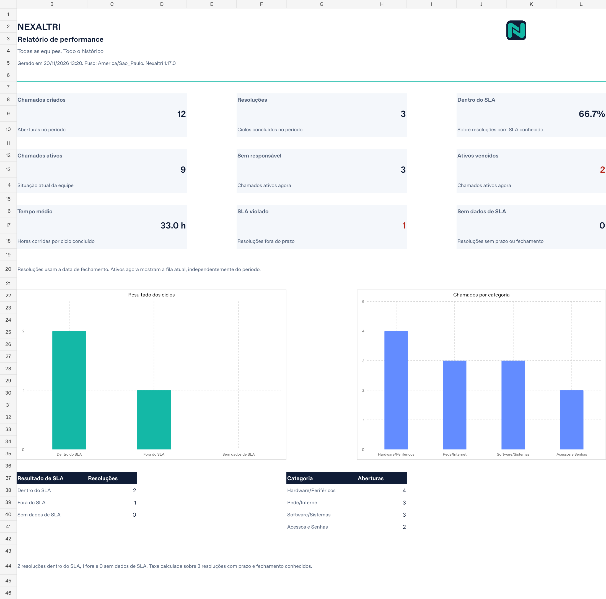
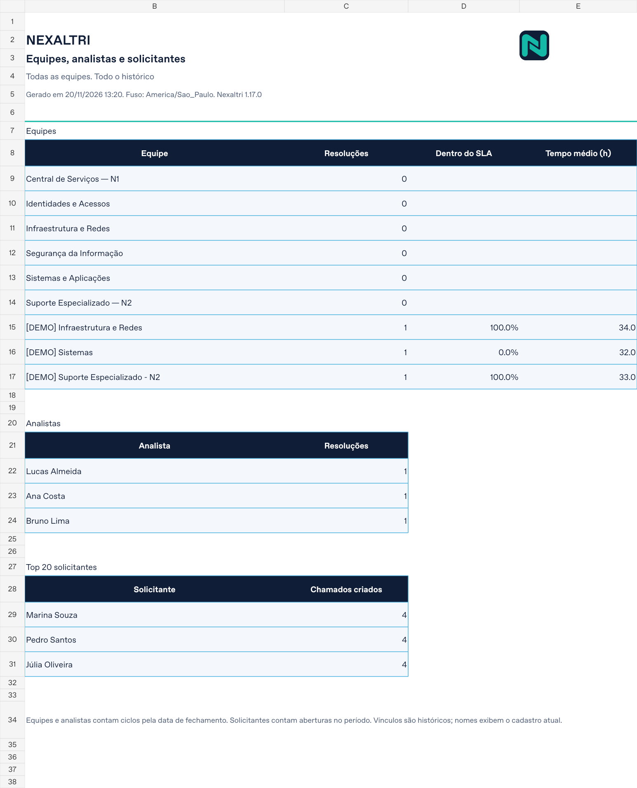
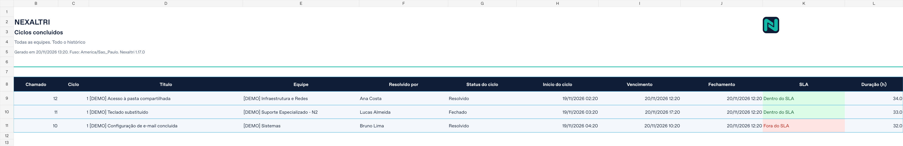

# Relatório Excel dos indicadores

Na v1.17.0, **Administração → Indicadores → Exportar Excel formatado** gera um arquivo `.xlsx` com a identidade Nexaltri. Selecione equipe e período e clique em **Aplicar filtros** antes de exportar.

CSV contém dados em texto simples. Para apresentar cores, marca, gráficos, formatos numéricos e múltiplas abas, use a exportação Excel. As duas opções ficam disponíveis no portal.

## Conteúdo

| Aba | Informações |
| --- | --- |
| Resumo | Chamados criados, ciclos concluídos, percentual dentro do SLA, ativos agora, sem responsável, ativos vencidos, tempo médio, resoluções fora do SLA e sem dados de SLA; gráficos de SLA e categorias; equipe, período e geração |
| Desempenho | Equipes com resoluções, SLA e tempo médio; resoluções por analista; top 20 solicitantes por aberturas |
| Resoluções | Número do chamado, ciclo, título atual, equipe e autor registrados, status do ciclo, início, vencimento, fechamento, SLA e duração em horas |

O arquivo traz cabeçalhos azul-marinho, monograma e acentos turquesa/azul da Nexaltri. Os gráficos são objetos nativos editáveis, ligados às suas tabelas de dados. As tabelas têm filtros e formatos de números/datas. O detalhamento congela o cabeçalho e os identificadores, com verde/vermelho acompanhado do texto para o resultado do SLA.

### Bases de contagem

O relatório usa os mesmos cálculos e filtros da tela. **Criados** e categorias seguem a abertura; **resoluções**, SLA e tempo médio seguem o fechamento de cada ciclo. **Ativos agora**, sem responsável e ativos vencidos mostram a fila atual da equipe, independentemente do período. Uma abertura não equivale a uma resolução.

Reabrir ou transferir o chamado preserva equipe e autor dos ciclos anteriores. Cada ciclo conta uma resolução. Títulos e nomes usam o cadastro atual; contas/equipes inativas continuam no histórico. O tempo médio considera somente fechamento igual ou posterior ao início do ciclo.

O percentual dentro do SLA usa apenas ciclos com prazo e fechamento conhecidos. Sem registros avaliáveis, a célula mostra **Sem dados**, sem inventar 0% ou 100%. O gráfico identifica separadamente os ciclos sem dados de SLA. Sem data de fechamento, um ciclo aparece somente em **Todo o histórico**. Campos de data e duração desconhecidos ficam vazios.

Os registros de Resoluções incluem todas as páginas dos filtros aplicados. O limite do Excel é respeitado; se o volume exceder a capacidade da aba, o formulário pede um período menor.

### Datas e edição

Datas e números são valores nativos, com formatos legíveis e possibilidade de ordenar/filtrar. As datas usam o fuso indicado no cabeçalho. O arquivo é uma fotografia dos dados na geração; editar uma célula não altera o portal nem consulta novas informações do banco. Para atualizar os dados, gere novamente o relatório.

Os gráficos se vinculam às tabelas do Resumo. Os totais de resoluções, o percentual de SLA e os contadores de violações/ausências nesse resumo têm fórmulas simples, com valores salvos para a primeira abertura. As demais métricas vêm dos cálculos compartilhados do servidor. A alteração manual de células não recompõe todos os indicadores do arquivo.

## Acesso e proteção dos dados

A rota `/administracao/indicadores/exportar.xlsx` exige administrador ativo, mesmo pelo endereço direto, e aceita somente GET. A resposta não fica em cache. Filtros inválidos retornam ao formulário com HTTP 400, sem iniciar download.

Descrição, solução, conversa, notas internas e anexos não entram na planilha. Textos são gravados como células literais, inclusive quando começam por símbolos de fórmula ou contêm URLs. O arquivo não contém macros nem vínculos externos.

## Prévias

As três imagens abaixo foram geradas com banco temporário e **dados fictícios de demonstração**. Não representam o banco de uma instalação.







## Atualizar e manter

Sem migração ou dependência adicional de execução. Pare portal e alertas, faça backup, atualize o código aprovado, execute a validação do projeto e reinicie. Em produção, colete os estáticos. [Procedimento Windows](inicializacao-windows.md).

O desenho do arquivo está em `helpdesk/report_templates/indicadores.xlsx`. A aplicação preenche dados, tabelas e caches dos gráficos preservando esse modelo; não usa Node ou serviço externo em execução. `scripts/gerar_modelo_indicadores.mjs` é a fonte de autoria visual, usada apenas no ambiente de desenvolvimento com a biblioteca de planilhas disponível.

`python scripts/prever_relatorio_excel.py` cria uma prévia em `artifacts/relatorio-excel.xlsx` com banco temporário próprio. Ela acrescenta autores e um atraso somente aos dados fictícios da prévia. Não consulta nem modifica o banco local da instalação.

## Validação do formato

A **v1.17.1** corrige a duplicação de `pageMargins` nas três abas do relatório. A v1.17.0 gerava XML legível e abria no LibreOffice, mas podia provocar o aviso de recuperação de conteúdo no Microsoft Excel. Depois de atualizar e reiniciar o portal, **baixe um relatório novo**; arquivos já exportados não mudam.

O teste Python confere a ocorrência única e a ordem das propriedades de impressão. O job `excel` usa o **Open XML SDK da Microsoft 3.5.1**, validando o modelo e um relatório com dados fictícios em banco temporário. Um controle negativo duplica as margens em memória e exige que o SDK rejeite essa estrutura. O banco da instalação não é consultado.

Para executar essa verificação opcional no desenvolvimento, com .NET SDK 10 instalado:

```sh
python scripts/prever_relatorio_excel.py
dotnet run --project scripts/validar-openxml -- helpdesk/report_templates/indicadores.xlsx artifacts/relatorio-excel.xlsx
```

O portal continua exigindo apenas suas dependências Python; .NET não é necessário para usar ou exportar o relatório. A checagem estrutural pelo SDK complementa os testes de dados, download no navegador e apresentação, e não representa automação do aplicativo Microsoft Excel.
