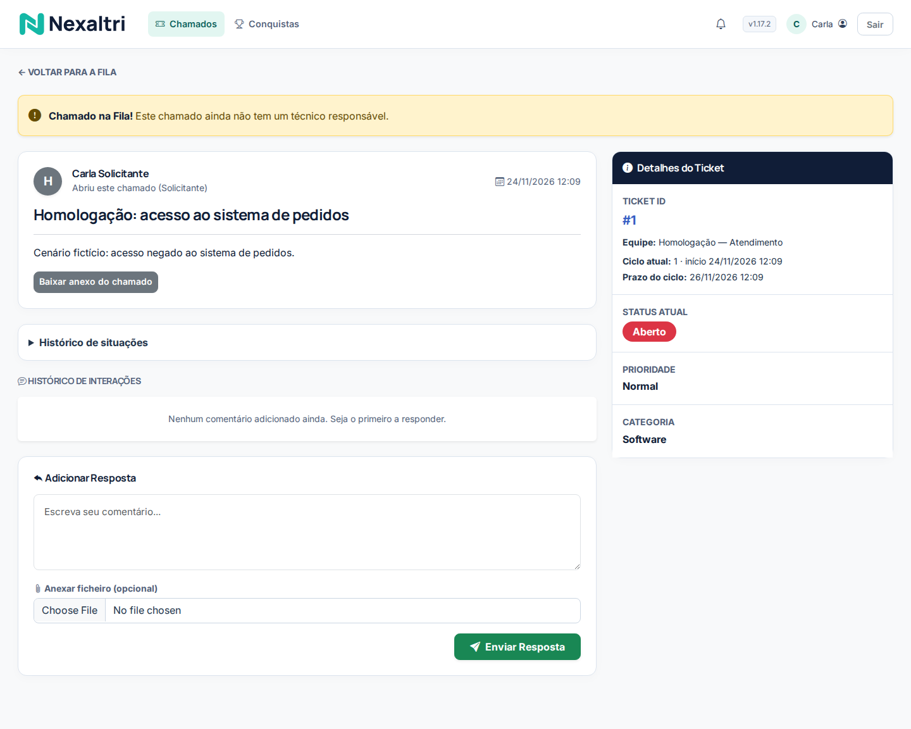
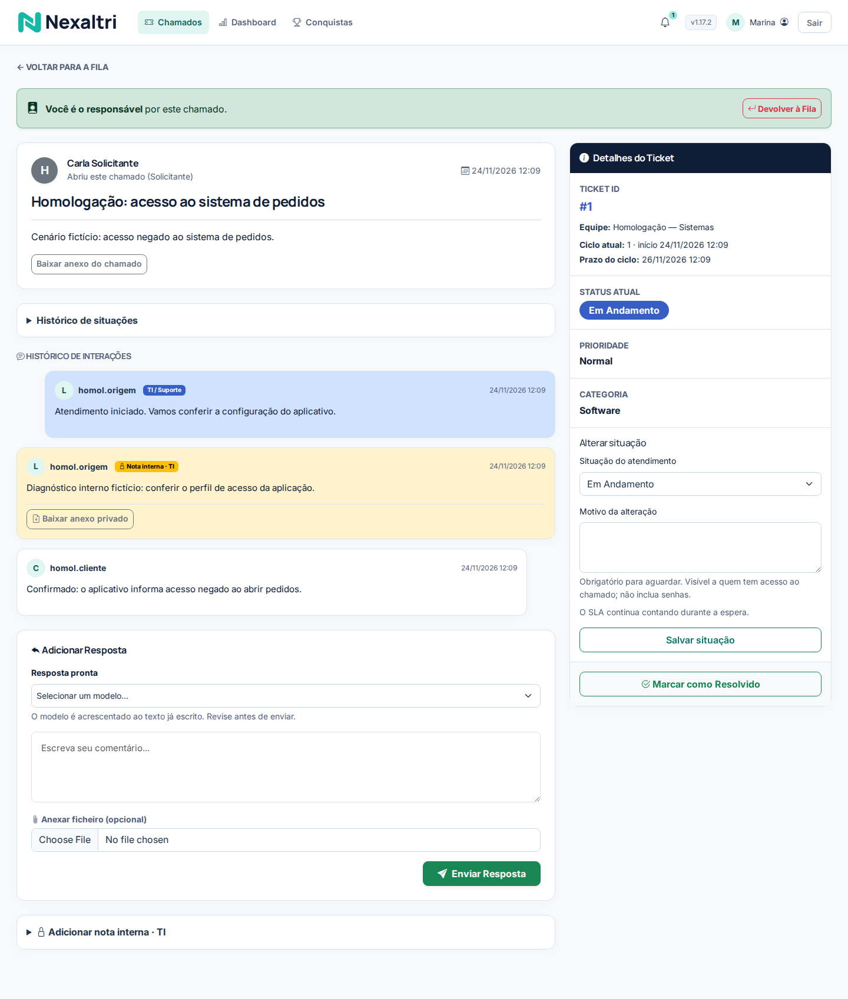
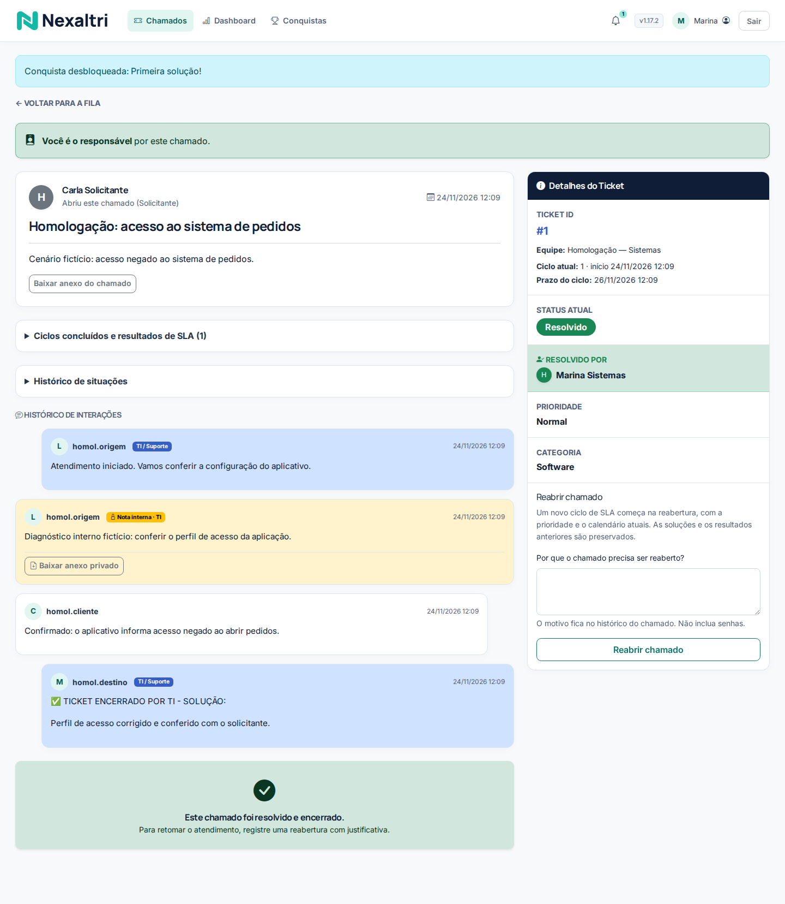
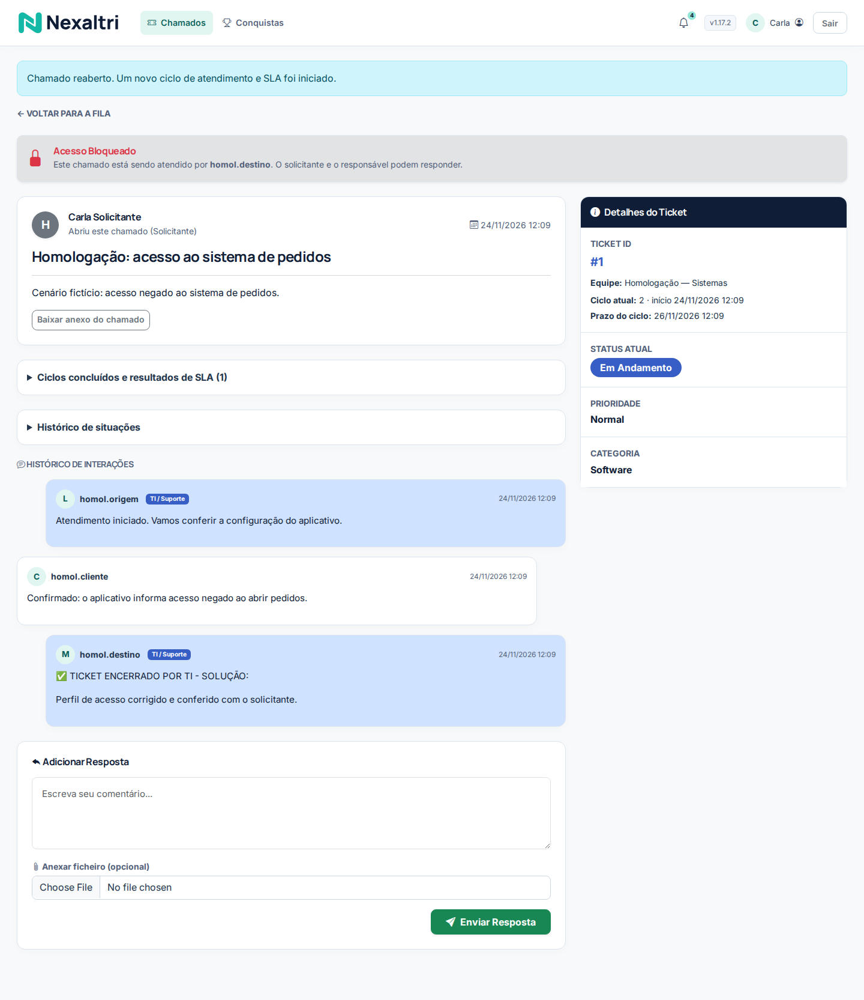
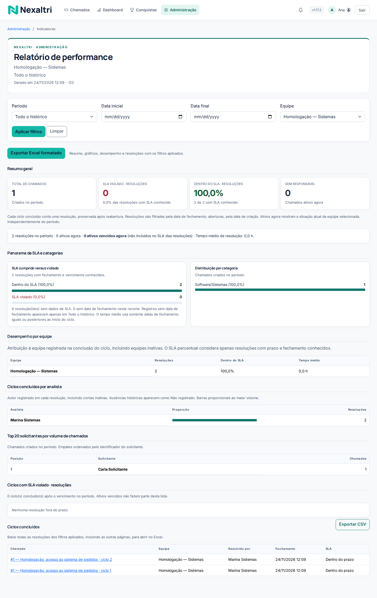
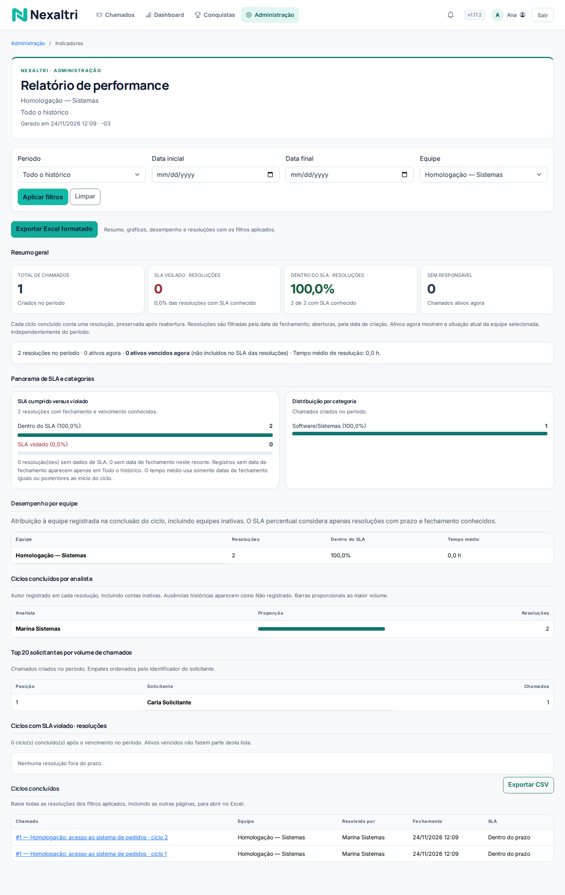

# Homologação funcional — Nexaltri v1.17.2

**Resultado funcional: aprovado nos 15 cenários, com uma observação de interface.** Execução em **24/11/2026, às 12:09 (America/Sao_Paulo)**, com contas, chamado e arquivos fictícios em banco temporário exclusivo. Não houve acesso à instalação do usuário.

## Evidência da revisão

- Aplicação de origem: `fa861f6aeed1ff5593e4f83095e884393a92898e` (main v1.17.2).
- Roteiro aprovado na branch: `80892a440accfd441ed7d27933321493dc93f5f5`.
- Revisão integrada usada pela CI: `2896b2adf676fb98edec83278b451b1f59546432`.
- Fonte do roteiro: blob `922669de011fb31fc5b055a323a60311a67e97ef`.
- [Execução aprovada no GitHub Actions](https://github.com/sonmook/portal-chamados/actions/runs/45421971634).
- [Resultados JSON e hashes das seis capturas](../imagens/homologacao-v1.17.2/resultados.json).

A revisão deste relatório e das capturas é documental: a aplicação continua na v1.17.2. O roteiro não exige publicar o portal para validar os formulários.

## Resultados

| Código | Verificação executada | Resultado |
| --- | --- | --- |
| HF-01 | Solicitante abre chamado com anexo; encaminhamento e prazo registrados | Aprovado |
| HF-02 | Outro solicitante não acessa chamado, anexo ou relatório administrativo | Aprovado |
| HF-03 | Técnico assume o chamado sem alterar o vencimento | Aprovado |
| HF-04 | Resposta pública aparece ao solicitante e gera notificação | Aprovado |
| HF-05 | Nota e anexo internos ficam restritos à TI sem notificar o solicitante | Aprovado |
| HF-06 | Espera por solicitante e resposta retomam atendimento preservando o prazo | Aprovado |
| HF-07 | Transferência preserva SLA e revoga o acesso técnico da equipe anterior | Aprovado |
| HF-08 | Resolução registra solução, autor, equipe e primeiro ciclo | Aprovado |
| HF-09 | Solicitante lê aviso e reabre com justificativa; histórico anterior permanece | Aprovado |
| HF-10 | Segunda resolução preserva os dois ciclos e a conversa | Aprovado |
| HF-11 | Administrador concilia indicadores: um chamado, duas resoluções e nenhum ativo | Aprovado |
| HF-12 | Download real de Excel e CSV mantém filtros, autores, números e dois ciclos | Aprovado |
| HF-13 | Auditoria administrativa e ausência de erros JavaScript | Aprovado |
| HF-14 | Backup e restauração isolada preservam todas as tabelas e arquivos privados | Aprovado |
| HF-15 | Aplicação restaurada permite login, histórico, anexos autorizados e os mesmos indicadores | Aprovado |

| Verificação complementar | Resultado |
| --- | --- |
| Suíte de regressão em Linux | 568 testes aprovados. |
| Suíte completa no Windows em pasta com espaços | 568 testes aprovados. |
| Interface em desktop, tablet e celular | 45 verificações aprovadas. |
| Excel baixado antes da restauração | Zero erros Open XML; controle negativo de margens duplicadas aprovado. |
| Excel baixado após a restauração | Zero erros Open XML; controle negativo aprovado. |
| Docker/HTTPS e restauração | Aprovados, com CA local verificada e mídia pública bloqueada. |
| Dependências e configuração | Jobs aprovados. |

O cenário gerou **um chamado**, transferido para a equipe de sistemas, **dois ciclos concluídos**, **duas resoluções dentro do SLA**, **100% de cumprimento do prazo** e **zero chamados ativos**. Tela, CSV, Excel e aplicação restaurada apresentaram os resultados esperados. A conversa e o primeiro ciclo foram preservados após a reabertura. Notas e anexos internos ficaram restritos aos perfis autorizados.

Na recuperação, todas as tabelas foram comparadas por conteúdo lógico antes de qualquer login na cópia; os arquivos privados foram comparados por SHA-256. O banco original foi preservado, inclusive durante a navegação na instância restaurada, que usou seu próprio banco e sua própria raiz de uploads.

## Capturas revisadas

Todas mostram dados fictícios. Arquivos originais da execução, sem edição; hashes conferidos contra o relatório JSON.

## Observação de interface — prioridade baixa

O banner **“Acesso Bloqueado”** aparece para o solicitante quando há um técnico responsável, embora o próprio solicitante continue autorizado a responder. Isso foi observado na captura de reabertura; o formulário permaneceu disponível e a resposta do solicitante foi validada no HF-06.

Recomenda-se ajustar o texto para indicar que o chamado está em atendimento e reservar uma mensagem de bloqueio para ações efetivamente indisponíveis. A observação não impediu os cenários funcionais e não foi alterada nesta homologação, que preserva o código da aplicação v1.17.2.

## Limites e reprodução

O roteiro confirma os fluxos descritos com dados fictícios e os perfis testados. Não abrange entrega SMTP externa, Google OAuth real, domínio público ou capacidade sob carga. Os avisos verificados são notificações internas. O aplicativo Microsoft Excel não foi automatizado; os arquivos foram conferidos por conteúdo e Open XML SDK.

[Roteiro e comandos para repetir](../homologacao-funcional.md). Os downloads de Excel/CSV e as capturas responsivas ficam no artefato `nexaltri-visual` da execução por 14 dias; as seis capturas funcionais e o JSON deste relatório permanecem versionados no projeto.
