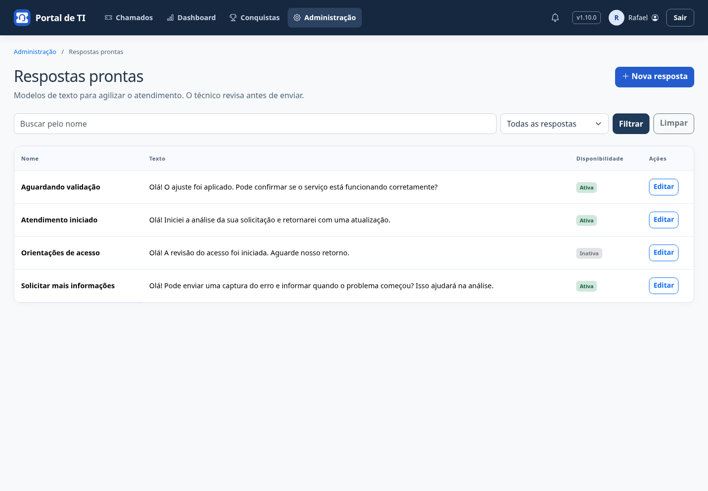
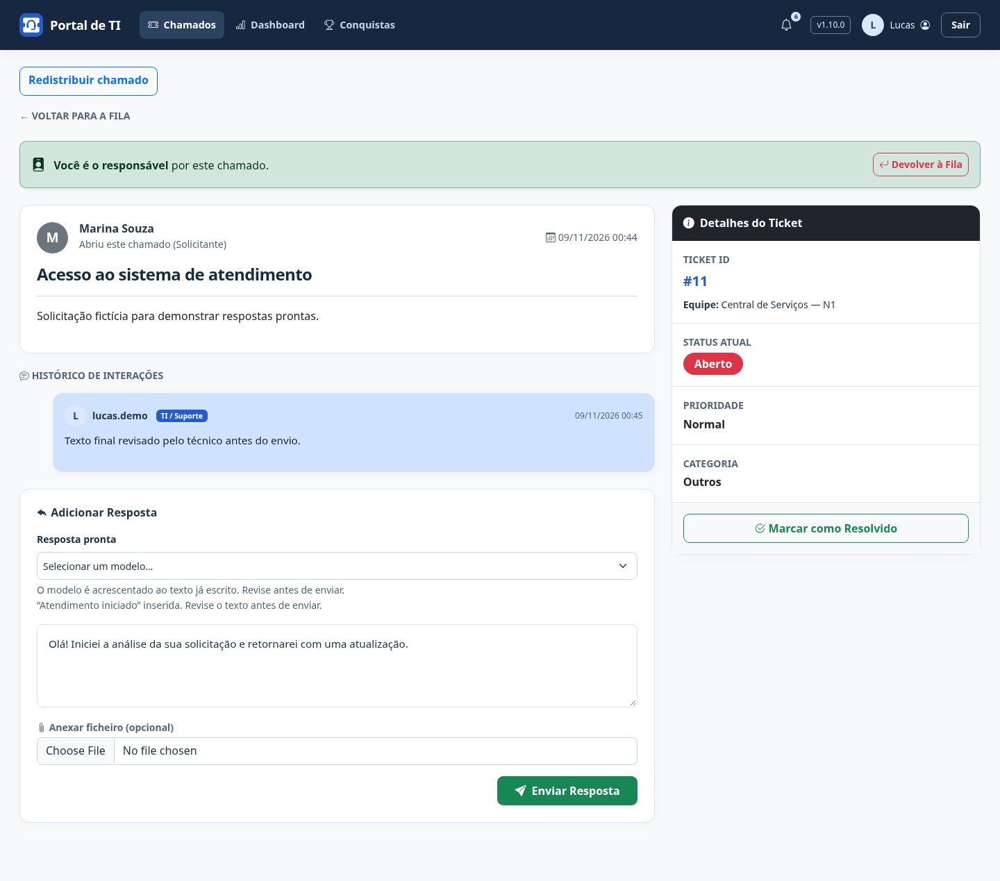

# Respostas prontas

Modelos de texto simples para agilizar a redação. O envio continua sendo feito pelo técnico após revisão.

## Administrar o catálogo

Administradores ativos acessam **Administração → Respostas prontas**. Podem buscar pelo nome, filtrar Ativas/Inativas, criar modelos e editar nome, texto e disponibilidade. A lista tem 20 modelos por página e mantém os filtros na paginação.

O nome é obrigatório, único e tem até 100 caracteres; o texto é obrigatório e tem até 4.000 caracteres. Desmarque **Disponível para os técnicos** e salve para desativar. Não há exclusão pela interface. Respostas já enviadas permanecem no histórico.

Edições verificam a versão carregada: se outra página já salvou alterações, a tentativa antiga é recusada com orientação para reabrir o formulário. Alterações são auditadas com responsável e campos modificados; o texto do modelo não é copiado para a auditoria. O único retorno de navegação é Administração no topo.

## Usar em um chamado

1. Abra um chamado ativo do qual você é o técnico responsável e integrante ativo da equipe.
2. Em **Adicionar Resposta → Resposta pronta**, escolha um modelo ativo.
3. O texto é acrescentado ao rascunho existente. Enquanto o modelo carrega, o envio fica indisponível.
4. Revise e adapte livremente o texto. Anexos já escolhidos são mantidos.
5. Clique em **Enviar Resposta** para publicar o texto final.

Selecionar um modelo não envia comentário, não gera notificação e não altera status, prioridade, SLA ou responsável. O envio usa as permissões, validações e notificações já existentes.

Solicitantes, técnicos não responsáveis e coordenadores não responsáveis não recebem esse seletor. Administradores gerenciam o catálogo, mas precisam cumprir as regras de técnico responsável para usá-lo em um chamado. Chamados finalizados, equipes inativas e perda de vínculo bloqueiam o carregamento.

O texto é consultado no momento da seleção, verificando novamente acesso e disponibilidade. Se o modelo foi desativado desde que a página abriu, ele não carrega e o rascunho é preservado. Um texto já inserido pode ser revisado e enviado normalmente, conforme as permissões do chamado. Alterar um modelo não reescreve comentários enviados.

Em caso de falha de rede, o rascunho permanece intacto. Selecione novamente para tentar outra vez. Se todos os modelos estiverem desativados, o formulário de resposta continua disponível sem o seletor. Sem JavaScript, é possível escrever e enviar respostas normalmente.

## Modelos iniciais e atualização

A migração **0026** cria **Atendimento iniciado**, **Solicitar mais informações** e **Aguardando validação**. Ela não cria comentários, usuários, notificações ou auditoria retroativa. Não há preenchimento automático de dados do chamado nem interpretação de HTML.

Pare portal e alertas, faça backup de banco e uploads, atualize o código e execute:

```powershell
.\.venv\Scripts\python.exe manage.py migrate
.\iniciar-portal.cmd
```

Em produção, colete estáticos e reinicie os serviços. Não há nova dependência. O catálogo integra o backup SQLite existente; a restauração preserva textos, disponibilidade e versões.

## Telas

Exemplos com dados fictícios.




