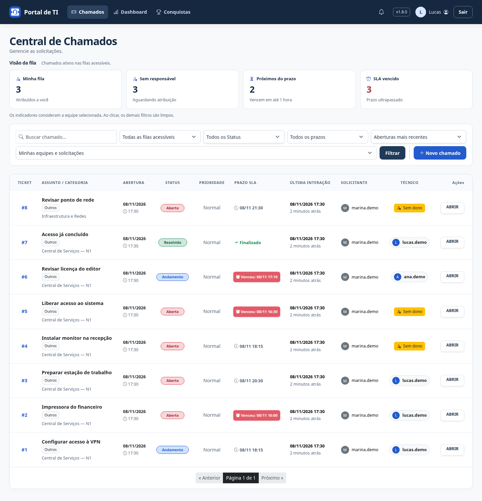
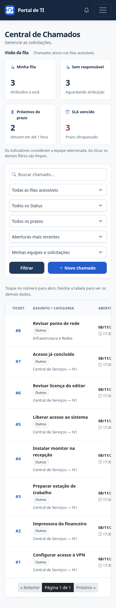

# Resumo operacional da fila

Técnicos e administradores encontram **Visão da fila** acima dos filtros na Central de Chamados. Os quatro indicadores usam somente chamados Abertos e Em Andamento aos quais a conta tem acesso.

| Indicador | O que conta |
| --- | --- |
| Minha fila | Ativos atribuídos à conta conectada |
| Sem responsável | Ativos sem técnico atribuído |
| Próximos do prazo | Ativos com vencimento entre agora e uma hora, inclusive |
| SLA vencido | Ativos com vencimento anterior a agora |

Resolvidos e Fechados não entram. Chamados sem prazo não entram nos indicadores de SLA. Um chamado pode aparecer em mais de um indicador: por exemplo, Minha fila e SLA vencido. As quantidades não devem ser somadas.

## Equipes e acesso

O resumo considera a equipe selecionada. Sem equipe selecionada, usa todas as filas acessíveis à conta. Administradores podem consultar todas as equipes; técnicos usam o acesso já existente às suas equipes ativas e às próprias solicitações. Escolher uma equipe não amplia permissões. Um técnico que perde vínculo deixa de ver os chamados dessa equipe, exceto suas próprias solicitações, conforme as regras do portal.

Para trocar a equipe, selecione-a no formulário e clique em Filtrar. Indicadores e lista serão atualizados. Equipe inválida ou inacessível retorna zero, sem revelar informações externas ao acesso.

## Clique nos indicadores

O clique mantém a equipe selecionada e aplica apenas o recorte escolhido. Busca, status, categoria, ordenação, página e os outros filtros de fila/prazo são limpos. Assim, a quantidade do indicador corresponde ao total da lista que ele abre.

Os números consideram somente a equipe e o acesso; não mudam conforme busca, status, categoria ou filtros combinados. O indicador fica destacado quando representa o filtro aplicado sem restrições adicionais de busca/status/categoria ou outro recorte de fila/prazo. Dados e prazos podem mudar entre cliques; a página é atualizada ao navegar/recarregar.

## Combinar filtros manualmente

O seletor de fila inclui **Sem responsável (ativos)**. É possível combiná-lo, por exemplo, com **SLA vencido** para encontrar chamados atrasados que aguardam atribuição. A paginação preserva os filtros. Limpar restaura a listagem padrão.

Solicitantes continuam acompanhando seus chamados sem indicadores de atendimento. A página não cria chamados de demonstração, avisos ou auditoria e não depende do processo de alertas para calcular os números.

## Atualização

Sem nova migração ou dependência. Faça backup, atualize o código aprovado, colete estáticos em produção e reinicie os processos. O processo periódico de alertas de SLA continua separado da aplicação.

## Demonstração

Capturas da v1.8.0 com chamados fictícios em uma instalação isolada.

